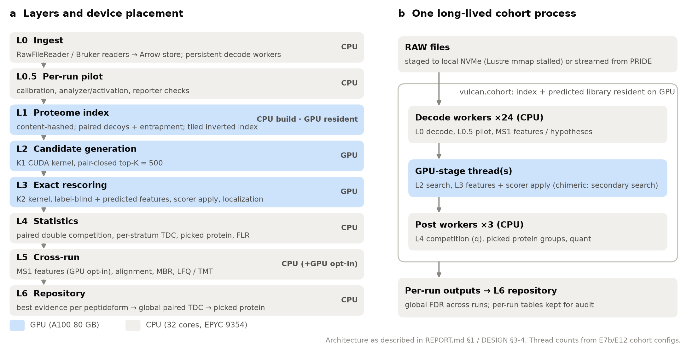
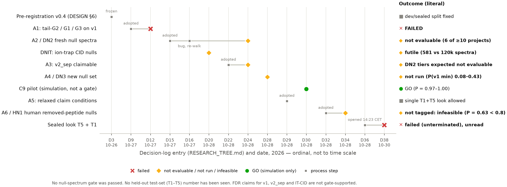
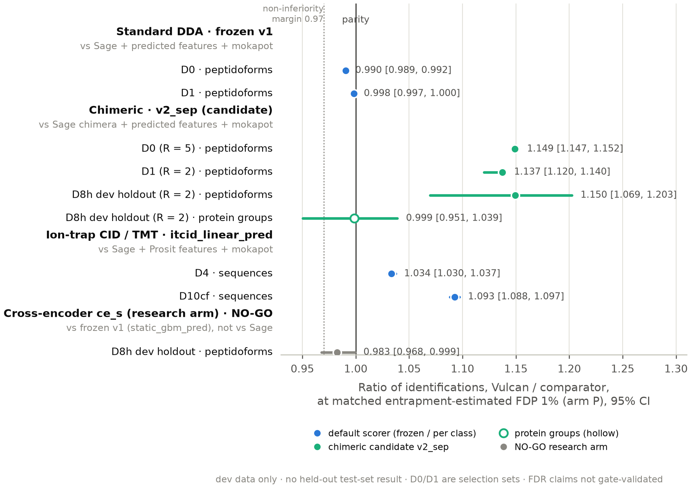
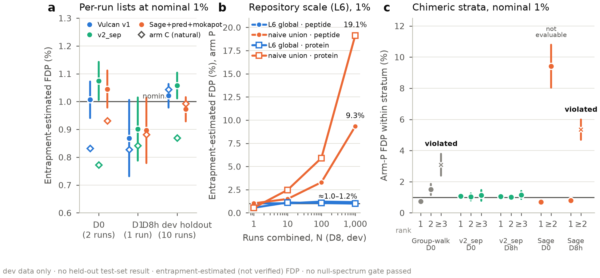
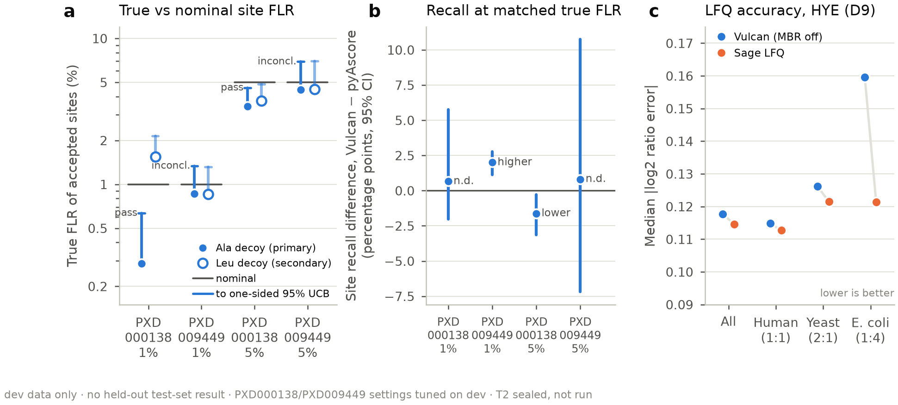
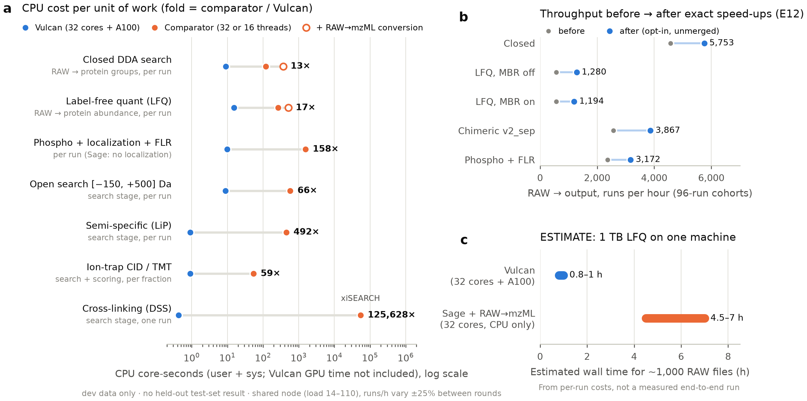

> **This work and this report were produced by an AI agent team (Claude Opus 5.5 / Sonnet 5.5). They have not been reviewed or verified by human experts.**

---

# Vulcan: a GPU-resident DDA proteomics engine with a pre-registered statistical protocol — technical report

Report date: 2026-10-30. Repository state: branch `master` at commit 226be1a and later; frozen look commit 4fe2e2a (tags `prereg-v0.4.3`, `prereg-v0.4.4`, `milestone-M7-2026-10-28`). Audience: computational proteomics specialists. All paths are relative to the project root unless stated.

**How to read this report.**
- Every number is from **development (dev) data** unless it is explicitly marked *sealed*. **No held-out test-set (T1–T5) result exists** (Section 7).
- *Nominal* means the FDR threshold that was requested. *Entrapment-estimated FDP* (FDP̂) is a false-discovery proportion estimated from entrapment sequences (arm P: paired shuffled; arm C: natural foreign proteome; arm M: memorization). *Verified FDP/FLR* is measured against a ground-truth design (synthetic phospho libraries, synthetic XL libraries, spike-in quant designs).
- Entrapment verdicts use the pre-registered words: *supported*, *supported-noisy*, *inconclusive*, *violated*, *not evaluable*.
- **No FDR claim in this report has passed the pre-registered null-spectrum gates.** The frozen v1 scorer FAILED the only completed null-spectrum test (Amendment A1); the contamination explanation for that failure is unconfirmed.
- Hardware of record: host gpu-node, 32 affinity cores of 2× AMD EPYC 9354 (Zen 4), one NVIDIA A100 80 GB PCIe, 1.5 TB RAM. The node was shared with other agents and users throughout (load average typically 14–110). Core-s = user + sys CPU seconds; it **excludes GPU time** (reported separately as GPU-s where available). Timings under the `flock` bench lock are marked; several comparator timings were taken unlocked and are indicative only.
- Results directories are cited inline as `results/<date>_<experiment>`. The E12 speed results exist only on the unmerged branch `worktree-agent-a0df6277cef40ec85` (commit 7f64a72) and are cited as `git:7f64a72:results/2026-10-28_E12_speed_abundance_ptm`.

---

## Executive summary

**What was built.** Vulcan is an open DDA search-and-quantification engine for Thermo (and, at the reader level, Bruker) data. It reads RAW files directly into an Arrow spectral store, calibrates each run with a pilot pass, and searches a content-hashed proteome index that is held resident on one A100. Candidate generation (CUDA kernel K1, a tiled inverted fragment index) and exact rescoring (K2) run on the GPU. A frozen, project-disjoint scorer over label-blind and predicted-spectrum/RT features replaces per-dataset semi-supervised rescoring, so one score serves target–decoy competition (TDC), stratified competition, picked protein groups and repository-scale (L6) FDR. A label-swap/permutation test (gate G0) checks that the GPU outputs do not depend on target/decoy labels. The same engine covers closed, chimeric, mass-offset/open, semi-specific and phospho search, decoy-amino-acid false localization rate (FLR), LFQ with optional match-between-runs (MBR) transfer FDR, TMT, cleavable and non-cleavable cross-linking (XL), limited-proteolysis (LiP) and co-fractionation (CF) workflows.

**Main dev results (accuracy and speed vs comparators).**

| Workflow | Accuracy vs comparator (dev) | Speed vs comparator (dev, shared node) |
|---|---|---|
| Standard DDA (frozen v1, `static_gbm_pred`) | 0.990× [0.989, 0.992] peptidoforms vs Sage + AlphaPeptDeep features + seeded mokapot at matched arm-P FDP̂ 1% (D0); +2.8% vs plain Sage (RT on) | search stage about 23–40× fewer CPU core-s than Sage (4 and 32 threads; CPU only, excludes GPU time); RAW → proteins about 5,700 runs/h at about 9 core-s/run vs Sage 70 (4 thr)–120 (32 thr) core-s + about 250 core-s for RAW→mzML |
| Chimeric search (candidate v2_sep) | 1.150× [1.069, 1.203] peptidoforms vs Sage chimera + predicted features + seeded mokapot on the 10-run D8h dev holdout (held out from selection, not a sealed test set); protein groups 0.999× [0.951, 1.039] | about 3,900 runs/h at about 15 core-s/run (E12 branch) |
| Ion-trap CID / TMT (`itcid_linear_pred`) | 1.034× [1.030, 1.037] (D4) and 1.093× [1.088, 1.097] (D10cf) vs Sage + Prosit features + seeded mokapot | about 0.9 core-s per fraction vs Sage about 54 core-s per file (16 threads, unlocked, indicative) |
| Label-free abundance | parity with Sage on ProteoBench DDA-Astral HYE (matched-set error 0.118 vs 0.1145) | about 1,200–1,280 runs/h at about 15 core-s/run vs Sage search + LFQ 266 core-s/run (+ about 250 core-s conversion) |
| Phospho + localization | Ala-decoy FLR point estimates calibrated or conservative; the stricter upper-bound rule is not met on PXD009449 (n = 183); mixed vs pyAscore; not run-to-run reproducible on about 0.7% of PSMs | about 3,200 runs/h; Sage 3,087 core-s for 2 runs without localization |
| Open search | −4% peptide stems vs Sage open | about 65–67× fewer core-s (search stage; 17.2 vs 1,153) |
| Cross-linking (DSSO D3b accuracy; speed on DSS D3) | about 73% of xiSEARCH heteromeric residue pairs on D3b, at lower verified FDP | on D3 (DSS): about 8,900× less wall for the search stage, about 460× less wall for the whole pipeline (about 50,000× fewer core-s for search + sites) |
| Repository-scale FDR (L6) | global peptide FDP̂ 1.16% (arm P) / 1.21% (arm C) and protein 1.00% at N = 1,000 (982 runs completed), vs 9.3% (peptide) and 19.1% (protein) for the naive union | streaming from PRIDE is download-bound at about 580 runs/h |

(Source table: REPORT.md §0, corrected against the primary results; per-row sources in Section 6. Core-s = user + sys CPU seconds and **excludes GPU time**; Vulcan uses an A100, the comparators run CPU-only on the same 32 cores, so core-s ratios favour the GPU node.)

**What is missing.** The project is **missing its held-out test-set comparison.** The single pre-registered sealed look (T5 + T1) opened on 2026-10-28 at 14:23 CET (ledger 13:23:46Z). T5 completed with exit 0. T1 was killed in its final scoring stage when the compute node was wiped (about 00:30 on 2026-10-29). The look was closed as **failed (unterminated)**, with all outputs deleted unread (ledger commit 742ba48). Nobody has seen any T1 or T5 number. T2 (FLR), T3 (XL) and T4 (repository sample) remain sealed. A5 allows at most two retries and only one attempt (attempt 1) has been used, so up to two retries from the same frozen commit (4fe2e2a) remain; a retry needs about 13 h of uninterrupted node time, including a check of the rebuilt mokapot environment (D38, D39).

**Statistical status, in the decision log's words.** v1 **FAILED** tail-G2, G1 and G3 under Amendment A1; the contamination explanation is unconfirmed. A2 (fresh nulls) was **not evaluable**. The IT-CID null set was **futile**. A3's null tiers for v2_sep were expected not evaluable by its own power check. A4 was **not run**. A5 knowingly relaxed the claim conditions so that the single look could proceed. A6/HN1 was **not tagged: infeasible** under its own tag rule. Error rates in this report are therefore entrapment estimates on dev data, and FDR claims for v1, v2_sep and the IT-CID scorer are not gate-supported.

**Speed in one sentence.** On the node of record, the closed DDA pipeline from RAW to protein groups costs about 9 CPU core-s per run (E12 branch; GPU time not counted) against 70–120 core-s for Sage's CPU-only search alone plus about 250 core-s for RAW→mzML conversion; for 1 TB of RAW files (about 1,000 runs) for LFQ on one machine, we *estimate* (not measure) 0.8–1 h for Vulcan against 4.5–7 h for Sage with conversion.

---

## 1 Goals and success criteria

### 1.1 Goal
The project brief (DESIGN.md §1) was to reprocess PRIDE-scale data with throughput limited by hardware rather than by the algorithm, at **no loss** of:
- identification sensitivity at *empirically verified* FDR;
- PTM localization accuracy (FLR);
- quantitative precision.

These were to be measured against Sage, MSFragger and DIA-NN on the same data. In practice MSFragger was not run (unlicensed) and DIA-NN was not run, because the DIA arm was dropped for lack of time (D31). The comparators actually used are Sage 0.14.7 (binary prints 0.14.6; commit 99407db6), Comet 2026.01, mokapot 0.10.0, xiSEARCH 1.8.12 + xiFDR, pyAscore, FlashLFQ, biosaur2 0.3.4 and MSstatsLiP 1.8.1 (Section 6).

### 1.2 Minimum credible deliverable
After three independent critiques of the v0.1 design (reviews/design_v0.1_{stats,hpc,domain}.md), the scope was cut to a minimum credible deliverable (MCD; D1): an open, GPU-accelerated **DDA** engine with
1. ingest that reads all centroids and infers per-run parameters (calibration, tolerances, analyzer/activation, labels);
2. closed, chimeric, mass-offset/open and semi-specific search with GPU matching;
3. static-first scoring with a frozen, project-disjoint, low-capacity model per instrument class;
4. exhaustive in-search localization with decoy-amino-acid FLR;
5. MS1 LFQ and TMT quantification;
6. picked protein groups and a global repository FDR shown to stay flat as the number of runs N grows;
7. cleavable XL-MS and semi-specific LiP-MS as demonstrations of stratified FDR and design-aware cross-run logic; CF-MS as a demonstration of transfer provenance and transfer FDR.

Research arms, each with a pre-stated go/no-go: frozen cross-encoder scorer (E6), bi-encoder retrieval (E5), spectrum clustering, DIA (Astral nDIA first), diaPASEF, non-cleavable proteome-wide XL.

### 1.3 Success criteria (pre-registered)
**Non-inferiority ("no loss").** On each sealed set, the lower 95% bootstrap CI of the ratio (our IDs / comparator IDs) must be ≥ **0.97**. The bootstrap resamples runs × decoy shuffles; both methods are averaged over the same 5 shuffled-decoy FASTAs. The ratio is computed at each method's own q ≤ 1% and at matched entrapment FDP. If the comparator's own control is not "supported", only the matched-FDP comparison is used (DESIGN §1). Analogous tests apply to FLR (site recall at matched true FLR), quantification (ε and CV with CIs) and speed.

**The bar** (DESIGN §1):

| Axis | Reference | Note |
|---|---|---|
| DDA speed | Sage 0.14.7, built locally | 32 threads and 4 threads; reported per core-s and GPU-s. Beating CPU Sage with an A100 is expected and is not by itself the claim. |
| DDA sensitivity | Sage+LDA, Sage+mokapot, Comet+mokapot; MSFragger if licensed | at entrapment-verified and matched FDP |
| Literature gains | Casanovo-DB +31–40% vs XCorr; DDA+ chimeric +15–57% | hypotheses, not bars |
| DIA (arm) | DIA-NN 2.7 Academia | not run |
| Global FDR | MassIVE-KB: merged per-dataset 1% gave ≈28% global FDR | our global FDP must stay flat in N |

**Status against the criteria.** Non-inferiority was demonstrated **only on dev data** (Section 6.1). The sealed test that would decide it was never completed (Section 7). "No loss" in this report therefore always means "non-inferior on dev, at matched entrapment-estimated FDP, against the named comparator".

---

## 2 Hardware and systems objective

### 2.1 Node of record
| Component | Specification (DESIGN §2; results/2026-10-27_hw_adapt) |
|---|---|
| Host | gpu-node (from 2026-10-27, D5) |
| CPU | 32 physical cores in the cgroup affinity mask, scattered over NUMA nodes 2–7 of a 2-socket AMD EPYC 9354 (Zen 4, AVX-512 incl. VPOPCNTDQ/BF16), SMT off. `os.cpu_count()` returns 64; all pools are sized from `os.sched_getaffinity(0)` via `vulcan.hw.n_threads()` |
| GPU | 1× NVIDIA A100 80 GB PCIe (sm_80, HBM2e ≈1.9 TB/s, 40 MB L2), driver 580.178.04, nvcc 12.9. Measured: fp32 matmul 18.6 TFLOPS (TF32 off), bf16 260 TFLOPS |
| RAM / disk | 1.5 TB; node-local NVMe `/tmp` 862 GB; project on Lustre (shared-fs) |
| Software | torch 2.14.1; cargo/rustc 1.99.1; CUDA kernels built for sm_80 + sm_86 + PTX |

**Earlier hardware.** M0–M1 ran on a 4-core EPYC 7742 slice with an RTX 3090 (24 GB). Results from that node (E1 ingest, stats simulations, first baselines) remain valid as recorded but are never mixed with A100-node numbers (DESIGN §2).

### 2.2 Objective and reporting rules
- **D0 (2026-10-26):** with only 4 CPU cores, the objective was CPU core-seconds per run and all matching moved to the GPU (D2), using a tiled inverted index rather than SpMM (the HPC review estimated that dense formulations do 100–1000× more work).
- **D5 (2026-10-27):** on the 32-core + A100 node the CPU is no longer the binding resource. The objective became **runs/hour end-to-end per node**, with CPU core-s and GPU-s per run still reported because they transfer to other allocations and to a cost model. Work goes to whichever device finishes the pipeline first.
- **Comparator fairness.** Sage and Comet get the full 32-core budget and are also reported at 4 threads. Small inputs penalise Sage at 32 threads: on Velos005137 (15,374 MS2) Sage used 56 core-s at 32 threads vs 8.6 at 4 threads for the same wall time (results/2026-10-27_hw_adapt). Core-s is therefore the transferable number. A locally built `sage-znver4` gave identical PSMs and no speed gain.
- **Portability.** Every result records `bench/hwinfo.py` output. A speed comparison is valid only if all arms ran on the same node in the same session.

### 2.3 Shared-node conditions
All measurements were taken on a node shared with other agents and users (load average 14–110 across experiments). Timed runs were serialised behind `flock /tmp/vulcan_bench.lock`, but unlocked work (Java, Lustre I/O, training) still ran alongside. Long comparators (xiSEARCH, some Sage runs) were timed unlocked. Absolute runs/h varied by about ±25% between rounds of the same experiment (E12). /tmp filled to 100% three times during the project, killing runs, and OOM events forced retries (REPORT §7). Per-session throughputs (E7b closed 5,433 runs/h; M2b 20k+; scoring_speed 5,658) measure different pipelines and are not comparable across rows.

---

## 3 Architecture (L0–L6)

**Figure 1** summarises the layers and device placement.

**Figure 1 | Vulcan architecture and CPU/GPU placement.** **(a)** Processing layers L0–L6, coloured by the device that runs them in production (blue = GPU; grey = CPU). The proteome index (L1) is built on the CPU and kept resident on the GPU. Candidate generation (L2) and exact rescoring with label-blind and predicted features (L3) run on the GPU. Statistics, cross-run quantification and repository-scale FDR (L4–L6) run on the CPU. GPU MS1 feature finding (L5) is an exact opt-in path. A label-swap/permutation test (G0) checks that L2/L3 outputs do not depend on target/decoy labels. **(b)** A single long-lived `vulcan.cohort` process keeps the index and the predicted-spectrum library on the GPU. Work flows through three stages: 24 CPU decode workers (RAW decode, per-run pilot, MS1 features); one or two GPU-stage threads (search and scoring); 3 CPU post workers (competition, picked protein groups, quantification). Per-run outputs feed the L6 global FDR. The schematic follows REPORT.md §1; the worker counts are the E7b/E12 cohort configuration. Qualitative schematic; no data values are plotted (reports/figures/SOURCES.md).

### 3.1 Design principles
- Each layer is a batch operator over Arrow tables with fixed schemas; there is no per-spectrum Python.
- **Label blindness.** L0–L3 never receive `is_decoy`, the pair side or the entrapment flag; these live only in L4 join tables (`labels.arrow`). Pair closure — scoring a target's paired decoy whenever the target is shortlisted and vice versa — is the one sanctioned exception, and it is label-symmetric by construction.
- **G0 test.** Swapping the labels of all pairs **and** permuting DB/pair storage order with hash-assigned ids must leave every L2/L3 output bit-identical. This catches positional leaks such as targets stored first, index-order tie-breaks and `rev_` prefix parsing. G0 passes for closed search, chimeric v2_sep (at the final freeze commit 06ce624), IT-CID (with the pinned prediction store), XL and semi-specific search.

### 3.2 L0: ingest and the Arrow spectral store
- **Readers.** Thermo RAW is read in-process with RawFileReader through pythonnet (`vulcan/io`, `thermo_direct`), Bruker with a native Rust reader, and mzML with a fast reader. Stores written from RAW are bit-identical to the mzML path (E1).
- **Store contents.** All MS1 and MS2 centroids are stored; nothing is discarded. Peak preprocessing (top-k per 100 Th, deisotoping, precursor removal) is a search-time view computed on the GPU (K0), so it can be ablated without re-ingest. The spectrum table carries identity, timing, precursor (m/z, instrument charge, isolation window, master scan, SPS ions), acquisition (activation, NCE, analyzer, resolution, FAIMS CV, filter string) and Bruker ion-mobility fields; TMT reporter peaks are extracted before any top-k.
- **Cost.** Direct Thermo ingest costs 17.8 core-s per 10⁵ MS2 (E1, old node; 19.2 on the new node), against 531 core-s for ThermoRawFileParser (TRFP) → mzML; the native Rust Bruker reader costs 26.9. In a persistent cohort worker the steady state is **6.5 core-s per 10⁵ MS2**, of which 48% is RawFileReader's own centroid decode (results/2026-10-27_M2b_cohort). The first E1 comparison against TRFP (531) was cold-Lustre inflated; on the new node TRFP→mzML on Velos cost 235 core-s per 10⁵ MS2 (results/2026-10-27_hw_adapt).
- **I/O rules (LESSONS 4).** RAW files are copied to node-local NVMe before decoding. Memory-mapping a Lustre RAW under the 256 GB cgroup limit turned 5 s decodes into 77 s. RawFileReader hangs (4 in about 6,000 runs) are handled by a supervisor that kills, respawns and retries after 30 s without CPU progress.

### 3.3 L0.5: per-run pilot calibration
On a seeded 10% subsample (seed 11), a wide-tolerance (±50/±50 ppm) closed search with common variable modifications (initially via Sage) yields calibration anchors: all rank-1 PSMs at spectrum q ≤ 1%, **decoys included**, so the anchor rule is a label-symmetric score threshold. The pilot outputs precursor and fragment error curves vs m/z and RT (stored as offsets, never baked into the index), empirical tolerances, analyzer/activation class (cross-checked against metadata), reporter-ion presence, a label-blind mass-offset histogram and isotope priors (results/2026-10-27_M2_ms1_pilot).
- On D0, the offset histogram found carbamylation (+43.006, urea) and formylation; TMT was detected correctly in a D4 SPS-MS3 positive control.
- **E0 (pilot on/off).** Recalibration alone was neutral for Sage (+0.01 to +0.05% peptides). Tightening tolerances to the calibrated error core cost 0.8–5.8% of peptides (deamidation read as isotope +1 falls outside the narrow window); slightly wider coverage-based windows gained 0.4–0.7%. **Decision D6:** keep calibration offsets and diagnostics; do not tighten tolerances.
- A bug was found in passing: Sage 0.14.7 flips the sign of asymmetric precursor windows, so only symmetric windows are passed to Sage.

### 3.4 L1: proteome index with paired decoys and entrapment families
- **Digestion** uses sage-core (commit 99407db6) through the `vulcan_core` PyO3 crate; it returns Sage's own f32 masses. Peptidoform records are compact (protein offset, length, mod mask, mass); fragments are generated on the fly from residue-mass prefix sums, and a dense fragment matrix is never materialised.
- **Decoys.** Pseudo-reverse with the protease C-terminal residue fixed, I/L equivalent; a target–decoy collision or palindrome is replaced by a shuffle seeded by hash(peptide, 1001, k). Each row stores `partner`, its symmetric pair row. Ids are xxhash64 of the canonical peptidoform; rows are sorted by (Sage f32 mass, id), so ids and tie-breaks do not depend on storage order.
- **Entrapment.** Entrapment peptides E_s get their own paired decoys: DB = T ∪ E ∪ dec(T) ∪ dec(E). Every entrapment peptide must be unique against all targets and all decoys of all five decoy seeds (1001–1005). Enforcing this rule (M1e) required 25,650 repairs (1.06%) for human P2001, and 1,839 targets (0.08%) remain unpaired (results/2026-10-27_M1e_baselines). An independent verifier re-derives every property (20/20 DB files pass).
- **Family tags and family-max entrapment.** Index entries carry a family tag (T, E_s, dec_d(T), dec_d(E_s), foreign, dec_d(foreign)). K1/K2 keep the top-2 per family per hypothesis, so each (decoy seed, entrapment seed) replicate's competition is reconstructed exactly from one search. Validation: 4/4 replicates exact on D1 and on D0 (2 decoy × 2 entrapment seeds), in 0.35 s vs 4.8 s for four separate searches on D0; agreement with the global top-K default on 99.97% of D0 top-1s (results/2026-10-27_M2b_cohort).
- **Content hash** = (FASTA bytes, enzyme, mod superset, ion types, decoy recipe and seed, entrapment recipe and seed, code version). Project mod sets are masks over the record mod field.
- **Index sizes on the A100.** Closed human + contaminants with one entrapment family: 14.1M peptidoforms, built in 2 min on CPU; production (T + dec) 7.06M in 40 s; D0 production K1 index 175,429,652 postings (equal to Sage's fragment count), 1.5 GB, built on the GPU in 0.53 s (results/2026-10-27_E2_gpu_search). Phospho/variable-mod index 184.5M peptidoforms, 34.3 GB resident, GPU build 6 s, CPU label assembly 446 s (444 → 81 s after E12, byte-identical). Semi-specific (yeast + SNCA) 33.3M peptidoforms, 7.1 GB.

### 3.5 L2–L3: CUDA kernels K0–K2
| Kernel | Implementation (results/2026-10-27_E2_gpu_search) | Role |
|---|---|---|
| K0 | torch on GPU | range filter, global top-150 (Sage-compatible) or top-k per 100 Th, mass sort, deterministic TIC |
| K1 | CUDA (`vulcan/gpu/kernels.cu`) | CSR over (chunk of 8,192 rows × 20-ppm log bin), u32 postings (u16 local id \| u16 fine log-ppm offset), 4 B/posting; one warp per (hypothesis, chunk tile), shared-memory u32 counters; threshold append (count ≥ 1, identical for every candidate), top-K per spectrum (ties to the higher row, never to a label), pair closure |
| K2 | CUDA, one block per spectrum, peaks in shared memory | Sage's `score_candidate` replicated in f32 with `-fmad=false`; features: hyperscore, matched b/y, intensities, intensity-weighted ppm, longest ladder, Δ to next and best candidate **regardless of label**, Poisson, Δmass and others |

**Query unit.** The precursor hypothesis: one row per (spectrum, charge, isotope error −1…+3, co-isolated MS1 feature). On D0, 2.04 precursor groups per spectrum (10.2 rows), 55.0% / 53.1% of MS2 with ≥2 feature groups (chimeric candidates), and 99.2% of Sage q ≤ 1% PSMs covered by a hypothesis row; the MS1 feature corrects the instrument monoisotopic assignment in about 20% of spectra (results/2026-10-27_M2_ms1_pilot).

**Correctness (E2).** G0 bit-identical under label swap and permutation (9/9 index arrays; D1 top-5 PSM table of 33,088 rows). K1 candidate sets identical to plain-f32 brute force on 3,000 spectra each from D0 and D1. Top-K recall vs exhaustive K2 at K = 500: targets 99.90%, decoys 99.78% on D0 production (|Δ| 0.12%); at Sage's K = 50 the test fails on D0 (96.8 / 93.3%), because a K-limited shortlist loses decoys first — hence K = 500 by default (+7% GPU time). Against the Sage oracle (same spectra, index and parameters), the top-1 peptidoform is identical on 99.83% (D1) and 99.23% / 99.38% (D0) of spectra; where the peptide agrees, hyperscores differ by at most 7e-15.

**Determinism fixes.** A non-deterministic float-atomic TIC and an arbitrary hypothesis pick for duplicated (spectrum, row) pairs were fixed (results/2026-10-27_M2b_cohort). One residual source of non-determinism remains in the **localization** operator, where GPU atomic sums break exact score ties at random (Section 6.6).

### 3.6 L3: label-blind and predicted features; the frozen scorers
- **Label-blind features** come from K2 (above) plus charge, length, missed cleavages, mass shift and the label-free chimeric rank from MS1 intensity.
- **Predicted features.** Fragment-intensity similarity (spectral angle, entropy) and RT residuals from AlphaPeptDeep for OT-HCD, with per-run NCE chosen from pilot IDs; Prosit CID/TMT-CID via Koina for ion-trap CID. Tryptic libraries are precomputed once per (proteome, instrument class): the OT-HCD library took a 43 min one-off build and occupies 25 GB GPU-resident (results/2026-10-27_scoring_speed). Koina predictions are not bit-deterministic (2.8% of entries differ after a rebuild), so all remote predictions go through a pinned, content-addressed store (`vulcan.predict.pinned`, 20.9M predictions; D20).
- **Predictor leakage rule (D4).** AlphaPeptDeep and DeepLC trained on PXD009449/PXD000138, our FLR sets, so PTM/FLR work uses only Prosit 2019 iRT / Prosit 2020 HCD (Koina) or MS2PIP HCD2019 for predicted features.
- **Frozen scorers.**

| Scorer | Class | Model | Status |
|---|---|---|---|
| v1 `static_gbm_pred` | OT-HCD DDA | GBM over label-blind + AlphaPeptDeep features, trained on 12 runs from 12 projects (13 selected; one IT-CID run excluded automatically; fold map committed), sha256 31bfe685… | frozen T1 primary (A1, D7) |
| v2_sep | OT-HCD chimeric | linear (C 0.01) over the v1 feature set, retrained on chimeric PSMs from 40 project-disjoint runs, per-stratum TDC | candidate, not claimed (A3) |
| `itcid_linear_pred` | IT-CID / TMT | linear over label-blind + Prosit CID/TMT features via pinned Koina store; 13 runs/13 projects | default for IT-CID (D20), FDR 'not gate-validated' |
| `ce_s` | research arm | cross-encoder, 1.66M parameters, bf16, K = 5 | NO-GO as default (D19) |

Because the static scorers are never fitted on the evaluated data, no RESET split is needed and one score serves all downstream statistics. RESET (semi-supervised rescoring with a held-out decoy half) is implemented as arm E4 (`vulcan/stats/reset.py`).

### 3.7 The cohort process
`python -m vulcan.cohort` runs one long-lived process (results/2026-10-27_M2b_cohort):
- **Decode workers:** a supervised pool of spawn processes, one thread each, that load .NET and RawFileReader once, copy RAW to NVMe, decode to the Arrow store and build search-ready arrays and the hypothesis table. Workers never import torch (that had cost about 7 core-s per worker).
- **GPU stage:** builds the L1/K1 index once and keeps it resident; runs K0 → K1 → top-K → K2 → features; later also scoring with the resident predicted library.
- **Writer/post workers:** competition, picked protein groups, quantification, parquet output and cleanup.
- **Startup:** a fresh process takes 13.2 s on the Lustre-hosted environment vs 2.6 s on the NVMe-staged environment; the cohort pays this once.
- **Capacity (200 page-cached dev runs, closed search to PSMs, no scoring):** 5,870 / 12,100 / 18,340 / 20,600–25,100 / 26,230 runs/h at 4 / 8 / 16 / 24 / 28 decode workers, at 2.5–3.8 core-s per run and about 0.06 GPU-s per run (NVML 20–25% busy). Decode binds (about 28k runs/h at 24 workers); the GPU stage has about 52k runs/h of capacity. **Uncached Lustre reads (1.27 GB/s at 16 streams) cap a cold cohort at about 6.5k runs/h**, so I/O is the next lever at repository scale.

### 3.8 MS1 feature finder (CPU and opt-in GPU)
- **CPU finder** (`vulcan/ms1`): biosaur2/Dinosaur-style hills, valley splitting, isotope envelopes with averagine and charge-harmonic rules. Rewriting hill linking as an O(n) two-pointer merge and removing an accept-without-trace shortcut cut the cost from about 650 to about 30 core-s per D0 run. Against biosaur2 0.3.4 on D0: recall 0.847 / 0.849, precision 0.646 / 0.635, mass robust SD 0.09 ppm; 87.2% vs 86.4% of Sage q ≤ 1% PSMs land on a feature with the exact monoisotope; 28.5–30.6 core-s per run vs 1,350–1,523 for biosaur2 (results/2026-10-27_M2_ms1_pilot). Synthetic truth gives ≥97% recall and precision.
- **E7b exact ports.** RT-binned isotope lookups and fused hill passes gave 1.9× fewer core-s with bitwise-equal tables on 13 runs (results/2026-10-28_E7b_fair_speed).
- **E11 GPU finder (opt-in).** Bitwise identical to the CPU path on 13 dev runs and in the cohort (ID Jaccard 1.0); MS1 12.4 → 1.8 core-s per D0 run (6.6×). Merged at cec4f37 with default `cpu`, so the frozen path is unchanged (results/2026-10-28_E11_gpu_ms1; D27, D31).

### 3.9 L4–L6 in brief
L4 implements paired double competition, CONGA-filtered and stratified TDC (Group-walk or per-stratum `sep`), picked protein groups, the decoy-amino-acid FLR and XL TT/TD/DD levels. L5 implements MS1 feature linking, star RT alignment, fixed-window XIC re-integration, Top3/MaxLFQ/directLFQ roll-up, TMT reporters with SPS-MS3 linkage, opt-in MBR with transfer q-values, LiP and CF logic. L6 aggregates the best evidence per peptidoform across runs into a global paired TDC and picked protein groups (`vulcan/stats/global_fdr.py`). The statistics are described in Section 4.

---

## 4 Statistical framework

The statistical protocol is DESIGN.md §6, frozen at git tag `prereg-v0.4` on 2026-10-27, before any sealed file was opened (the ledger was empty; an earlier `prereg-v0.2` tag referred to in DESIGN had never been created). Any change needs a dated note in RESEARCH_TREE.md written before the affected results are seen. Six amendments followed (A1–A6, §6.0–§6.0e); their history is told in Section 4.10.

### 4.1 Paired double competition
1. All precursor hypotheses of a spectrum compete together.
2. PSM-level target–decoy competition (TDC).
3. Peptide-level competition between each target and its own paired decoy (DDA), i.e. the pair ids stored in L1.

The estimate is FDR̂ = (D + 1)/T, made monotone. Ties are broken by hash(sequence, seed), which is permutation-invariant; decoys are counted first at equal scores. Monte-Carlo verification (≥10⁴ replicates; pass if mean − 2.326·SE ≤ α) is required for TDC, paired double competition, Group-walk, RESET and the picked group (DESIGN §6.7). All estimators met mean FDP ≤ α at 1% (results/2026-10-26_stats_sims). The same simulations showed that the **paired and combined entrapment upper-bound estimators overstate FDP by about 20%**: a correctly calibrated TDC list with true FDP 0.0104 at α = 1% has a paired mean of 0.0124. Well-calibrated methods therefore often read "inconclusive" rather than "supported" (DESIGN v0.3.1).

### 4.2 Stratified competition for chimeric and open search
- **Strata** (≤2 factors per mode): closed — specificity × label-free chimeric rank; open — CONGA stem/offset bin; PTM — composition. Strata membership is identical within a pair. Pre-registered merges: adjacent offset bins, rare PTM classes into "other", chimeric rank ≥3 pooled. The minimum stratum size (200 pair-competitions, counted label-blind) is a power rule, not a validity rule.
- **CONGA** for open and chimeric search: a label-blind neighbour filter drops any PSM sharing more than 5% of b/y ions (chimeric: a b/y index ≥3) with a higher-scoring PSM of the same spectrum, followed by stem-level competition.
- **Group-walk** controls only the overall list. On chimeric search it violated stratum ≥3 on D0 (Section 6.2), so v2_sep uses per-stratum TDC (`sep`) instead.

### 4.3 Picked protein groups
Picked Protein Group FDR (The & Käll), with the group score equal to the **best peptide score** (not a product of PEPs). Razor and Occam assignment are never used for FDR. Rescued subsets are to be checked by protein-level entrapment with paired shuffled entrapment *proteins*; a group with ≥1 original target counts as a target (DESIGN §4 L4, §6.3).

### 4.4 Entrapment arms P, C, M and the verdict rule
| Arm | Construction | Estimator |
|---|---|---|
| **P** paired shuffled | FDRBench-style, r = 1, one entrapment per target, with its own decoys; dev seeds 2001–2003, sealed 2004–2006 | FDP̂_P = (N_E + N_{E≥s>T} + 2·N_{E>T≥s}) / (N_T + N_E) |
| **C** combined, natural foreign | *Arabidopsis* for human samples, after removing I/L-identical, single-substitution and isobaric (N↔GG, Q↔AG) neighbours; r on the effective search space, reported per mass decile | FDP̂_C = N_E(1 + 1/r)/(N_T + N_E) |
| **M** memorization | high-resolution sample from an organism absent from training (yeast), searched with human peptides as entrapment, subsampled to r ≈ 1 | as C |
| Lower bound | — | LB = N_E/(N_T + N_E), failure detector only |

Required arms: static low-capacity scorers (including predicted-feature linear/GBM) need P and C; models with sequence capacity need P, C and M; A1 made arm M required for predicted-feature scorers. The statistic is the mean FDP̂ over replicates (entrapment seeds × decoy seeds) with a 95% CI from bootstrapping target–entrapment pairs combined with between-seed variance.

| Verdict | Condition |
|---|---|
| Supported | mean FDP̂ ≤ α **and** upper 95% CI ≤ 1.5α, for each required arm |
| Supported-noisy | mean ≤ α but upper CI > 1.5α |
| Violated | the lower CI of the mean LB > α |
| Not evaluable | α·N_T < 20 |
| Inconclusive | anything else |

"Consistent with control" (lower CI of paired FDP̂ ≤ α) is a weaker statement, always labelled as such, and is never used to rank scorers. Gated levels are α ∈ {1%, 5%}; 0.1% and 0.5% are reported, not gated. FDP comes from the augmented (entrapment) search; sensitivity comes from the production search without entrapment. **CI convention (A1.6).** A simulation (10⁴ replicates × 4 scenarios) compared (a) bootstrap plus between-seed variance with (b) bootstrap only: coverage 0.937–0.947 for (a) vs 0.817–0.841 for (b), so (a) was adopted (results/2026-10-27_M3e_hardening).

**Repository scale.** At N = 1,000 runs, replication is reduced to 1 entrapment seed × 1 decoy seed (pre-registered, DESIGN §7).

**Secondary arm C (D18).** Because natural foreign nulls beat their reversed decoys 54.4% of the time (Section 6.12), a secondary, *reported-only* arm C was pre-registered before any sealed access, with an outcome-independent screen (exclude entrapment peptides sharing a ≥4-ion b/y ladder with any human target, or coming from plastid/photosynthesis/food-taxon proteins). It never changes a verdict.

### 4.5 Gates G0–G5 for learned or predicted components
All gates must pass before any FDR claim (DESIGN §6.4; A1 made G1, G3, G4 and tail-G2 required).

| Gate | Definition (pre-registered) |
|---|---|
| **G0** label blindness | Label swap of all pairs + storage-order permutation leaves every L2/L3 output bit-identical |
| **G1** | On null spectra, scorer output must not correlate with a sequence-only target-vs-decoy classifier's logit in the top score decile: \|Spearman ρ\| < 0.05 (99% CI) |
| **G2** differential null test ("G2-original") | The learned pipeline's null target-win rate may exceed the fixed-score pipeline's, on the same null competitions, by ≤ 0.01 overall and ≤ 0.02 in the fixed-score top decile (one-sided 95% upper bound; ≈120k null competitions per instrument class). Null spectra: n + 0.5 ± 0.1 Da precursor offsets and homolog-filtered wrong-species spectra in a mixture design |
| **tail-G2** (A1) | On clean null spectra passing the method's own 1% threshold: n_tail ≥ 200; one-sided 95% UB of target fraction ≤ 0.60; one-sided 95% UB of (learned − hyperscore) tail target fraction ≤ 0.10. n_tail < 200 → "not evaluable", which blocks claims |
| **G3** retrieval symmetry | For any pruning/ANN/lazy stage, recall of best target and best decoy vs exhaustive, on null spectra binned by score, must agree within 1% |
| **G4** calibration across strata | Decoy score quantiles per (instrument, activation, charge) comparable; KS threshold fixed on dev; decided on training or dev decoys only |
| **G5** leak alarm | On G2 nulls, AUC separating target winners from decoy winners ≤ 0.55 |

A caveat added late (D34): the A6 statistics acceptance test showed that the **percentile cluster bootstrap behind G2-original undercovers at J ≈ 37 clusters (0.923–0.944 vs 0.95)**. Earlier G2-original "pass" results that relied on such a bootstrap with few clusters are therefore weaker than nominal. G2-original was also nearly vacuous for re-scorers (the winner changes on only 0.08–0.19% of null competitions; m3_independent_review).

### 4.6 RESET (arm E4)
RESET is required whenever a score is fitted on the data being evaluated. Single-decoy mode: winning decoys after peptide competition are split by a seeded half; FDR̂ = 2(D_est + 1)/T; training constant 3. Two-decoy mode: decoys from two independent shuffles; factor 1; constant 2. Estimating decoys enter training as unlabelled pseudo-targets. RESET plus Group-walk and RESET plus picked protein are unproven, so RESET mode reports only pooled peptide-level FDR. The frozen static scorers need no RESET.

### 4.7 False localization rate with decoy amino acids
- FLR̂ = n_pA · (N_STY / N_A) / n_pSTY, where n_pA counts accepted localizations on the decoy residue and N_STY, N_A count candidate acceptor residues in the localized peptides (Ramsbottom et al. 2022). **Ala is primary**; Leu (I counted as L) is secondary. Mono- and multi-phospho are reported separately; sites are stratified by whether another acceptor lies within 2 residues.
- **D8 (before any T2 access):** FLR̂ is counted at the **PSM level** (the unit used in dev E8); a site-level FLR̂ is secondary. The Leu decoy's slight underestimation is reported, not tuned away.
- The localization operator enumerates all site configurations, including decoy-residue configurations, and scores site-determining ions blind to residue identity given masses. Decoy residues enter only here, never in identification.
- **E8 (FLR̂ vs true FLR) is a gate** before any FLR claim. The T2 driver adds a stricter cell rule: a cell passes only if the one-sided 95% upper bound of true FLR is ≤ α.
- Dataset roles: dev/calibration = PXD007058 (Ferries; proxy truth), dev subsets of PXD000138 and PXD009449; sealed (T2) = held-out PXD009449 pools + held-out PXD000138 subset. Pools with positional isomers are excluded. PXD007058 proxy truth (declared at commit 97daf98 before use): submitter MaxQuant sites with max site probability ≥0.99 in ≥1 PSM, ≥90% PSM agreement, no positional isomer, sequences mapping only to sealed T2 wells excluded (72 sequences, 194 PSMs).

### 4.8 Cross-linking: TT/TD/DD and the homo-family class
- FDR̂ = (TD + 1 − DD)/TT ("+1" variant), clipped at 0, always reported with the conservative (TD + 1)/TT. A level is reported only if TT ≥ 50. CSMs are merged to the reported level (CSM → residue pair → PPI) before FDR at that level.
- Self vs heteromeric links are separated by FDR (a link involving decoy-A of protein A counts as self); every CSM needs fragment evidence for both peptides (score = min of the two peptides' evidence); linear, mono-link and loop-link explanations compete in the same search.
- **Homo-family class (D10).** Pairs whose two sides are the same peptide up to target↔decoy pairing can win only as TT or DD, never as TD, so (TD + 1 − DD)/TT is biased for them. On dev the merged self class reached 16% true FDP at nominal 1% before the split. These pairs are flagged label-free in L3, excluded from TT/TD/DD and **reported as a separate, non-FDR-controlled class**. This is a structural validity fix that costs sensitivity.

### 4.9 MBR transfer FDR, CF transfer, and L6 global FDR
- **MBR** is opt-in. Every transfer carries a transfer q-value from PIP-ECHO-style decoys (decoy-peptide donors plus RT- and m/z-shifted decoy peaks) and a provenance flag; transfers are never counted as identifications. Default: donors at ID q ≤ 0.1%, features claimed by MS2 IDs excluded, per-run q.
- **CF-MS** uses a run-specific detection q-value per fraction, provenance flags and a profile-agnostic, **fraction-local** transfer FDR; there is no profile-continuity prior (it would inflate the co-elution correlation that CF-MS scores) and no global normalization.
- **LiP-MS** never transfers between LiP and TrP runs; semi-specific decoys come from decoy proteins so class counts match.
- **L6 global FDR** (`vulcan/stats/global_fdr.py`): best evidence per peptidoform across runs → global paired TDC → picked protein groups. Each project is scored by the fold model that never saw it. Outputs: a master list with global q, per-run lists with run q, and expected false counts q × N. Calibration and G4 are decided on training or dev decoys only.

### 4.10 Pre-registration and amendment history (told as it happened)

The pre-registration went through two design-review rounds and six amendments in three days. The history matters because the final error-control status of the engine is the product of these steps, including their failures. **Figure 6** summarises it.

**Figure 6 | History of the pre-registered statistical gates (honest summary).** The x-axis lists decision-log entries in RESEARCH_TREE.md in order, with their dates; spacing is ordinal, not to time scale. Each row is one gate, amendment or attempt. Markers show process steps (grey squares: adopted, opened) and outcomes, with status colour plus icon and label: red cross = failed; amber diamond = not evaluable / not run / infeasible / futile; green circle = GO in simulation only, not a gate. The outcomes, in the decision log's words: A1 (tail-G2, G1, G3 on frozen v1): **FAILED** — a post-hoc contamination explanation is unconfirmed. A2/DN2 fresh nulls: **not evaluable** (6 of ≥10 projects admitted, after a re-walk to fix an implementation bug). IT-CID nulls: **futile**. A3 v2_sep tiers: expected not evaluable. A4/DN3: **not run** (simulated P(v1 minimum) 0.08–0.43; P(clean v1 passes) about 0.06–0.4; D28). C9 pilot: GO by simulation. A5: knowingly relaxed the claim conditions to allow a single T1 + T5 look. A6/HN1: **not tagged: infeasible** (P(v1 minimum) = 0.63 < 0.8 at the measured throughput). Sealed look (opened 2026-10-28 14:23 CET): T5 completed; T1 was killed when the compute node was wiped, and the look was recorded as **failed (unterminated)** with outputs deleted unread; up to two retries from the frozen commit remain allowed under A5. No null-spectrum gate was passed, and no held-out number has been seen.

#### 4.10.1 Design reviews (D1, 2026-10-26)
Three independent critiques of DESIGN v0.1 (domain, HPC, statistics) and a round-2 critique shaped v0.2–v0.3. The domain review found the front end (calibration, charge/isotope, MS1 features, ion models) close to absent and the scope "several tool-years" wide; the HPC review showed that a dense SpMM formulation does 10²–10³× more work than an inverted index and that Sage should be reused rather than rewritten; the statistics review removed a label-leaking feature ("Δscore to best decoy"), added arm M and a CI-based verdict table, and turned G2 into an equivalence test. The round-2 review showed that G2 at n = 16.6k could never pass (99% CI half-width exactly 0.01), so G2 became a differential test per instrument class (≈110k null competitions) on n + 0.5 Da offsets and homolog-filtered wrong-species spectra; scoring became static-first with RESET as an arm; and the FLR truth roles were swapped (PXD009449/PXD000138 pools sealed, PXD007058 dev).

`prereg-v0.4` was tagged on 2026-10-27 (019753e) with an empty sealed ledger.

#### 4.10.2 A1 (D9, `prereg-v0.4.1`, ecca183) — FAILED
The independent M3 review (reviews/m3_independent_review.md) found no label leakage but judged a sealed look unjustified: the T1 protocol was not implemented, G1/G3/G4/arm M had not been run, G2 was nearly vacuous for a re-scorer, the nulls were contaminated by homologous yeast spectra, and the Sage reference had run with RT prediction off. Every A1 item makes the protocol stricter: freeze v1 (sha256 31bfe685…) as the only T1 scorer; add tail-G2 with fixed margins; homolog-filter and RT-map the nulls; require G1, G3, G4 and arm M; choose the CI convention by simulation; quote gains against the strongest comparator.

**Outcome (results/2026-10-27_M3e_hardening; D12).** Six null projects (D1 Pfu, D7 yeast, and DN: *T. brucei*, *S. aureus*, *Synechococcus*, *B. cereus*), 894,579 species nulls in 45 mixtures of 20,000 with D0 hosts, 81,390 clean after the homolog filter:

| Gate | Result | Values |
|---|---|---|
| G2-original | pass | diff −0.00002 (UCB 0.00014); top-decile UCB 0.0005; winner changed on 0.08% |
| **tail-G2** | **FAILED** | n_tail 751; target fraction 0.715, UCB 0.742 > 0.60; diff vs hyperscore +0.085, UCB 0.124 > 0.10 |
| **G1** | **FAILED** | ρ 0.048, 99% CI [0.019, 0.076] (n = 8,139); hyperscore 0.028 [−0.001, 0.056] |
| **G3** | **FAILED** | on the clean-null subset (n = 1,529) one bin: recall_T 0.9897 vs recall_D 1.000 (Δ 1.03 pp, about 100 per bin); passes on all nulls (max \|ΔR\| 0.12 pp) |
| G4 | pass (weak) | τ = 0.538 |
| G5 | pass | 0.506 [0.502, 0.510] |
| Arm M (D7) | inconclusive, not violated | FDP̂_C 1.049% vs hyperscore 1.046% at 1% |

A post-hoc diagnosis located the tail and G1 signal in *S. aureus* PXD023811, whose tail targets are human skin proteins (DSP 54, DSG1 29, JUP 13, …), and in offset nulls that are shifted copies of real human spectra; excluding them, tail-G2 and G1 would pass (tail fraction 0.44, UCB 0.485; ρ 0.004). **Because this explanation was found after seeing the failure, it was not allowed to re-score the existing nulls; the failure stands as recorded (D12), and the contamination explanation is unconfirmed.**

#### 4.10.3 A2 (D15, `prereg-v0.4.2`, 40d9fb9) — not evaluable
A2 (reviews/amendment_A2_draft.md, adopted verbatim; implementation ce53769, tests 104/104) specified a fresh null set DN2 with label-swap-invariant admission, admission hashes committed before any gate statistic, unchanged A1 margins and a one-shot rule (P4: a fail is final; "not evaluable" blocks). It also tightened G1 and G3 and set a walk (`Random(23)`, one project per genus, 3 RAWs per project; stop at ≥10 projects, |A| ≥ 120k, tail proxy ≥ 400).

- **D16:** the first walk admitted 0 projects because of an implementation bug (the UniProt query `proteome_type:1` returns nothing; a genus-only proteome match was also wrong). Both were fixed as an implementation correction and the walk was re-run **once** with the same seed. The verbatim keyword list, which over-excluded 37 projects, was kept, because changing it after seeing the yield would have been outcome-driven.
- **D24:** the re-walk exhausted its pool at **6 projects / 18 runs** (minimum 10). Label-free sizes: |A| = 24,581 vs 120k needed; tail proxy 22 vs 400 (results/2026-10-27_A2_dn2). Step 4 was not run and no label or gate quantity was ever computed. **A2 is not evaluable.**

#### 4.10.4 IT-CID nulls (DNIT) — futile
For the ion-trap scorer, a separate null walk (rules committed at 2814f06 before listing) admitted 3 projects with |A| = 581 and tail proxy 0; the ±0.5 Da identity screen removes 86–89% of certified spectra. The projection was about 3,100 vs 120,000 needed, so the walk stopped for futility; tail-G2/G1/G3 are not evaluable and DNIT is spent (D20).

#### 4.10.5 A3 (D22, adopted; tag deferred to `prereg-v0.4.3`) — expected not evaluable
A3 added v2_sep (gated, claimable) and ce_s (gated, licenses nothing) to the single DN2 step-5 run in two tiers, and added v2_sep as a pre-registered secondary T1 arm with its own error family S (FWER 0.025, fixed sequence: non-inferiority ≥0.97 at matched FDP 1% and own q 1%, then more peptidoforms, protein groups, IDs at 5%, IDs at own q). The independent review of rev 0 said "do not adopt as written" (6 blocking, 14 major issues, among them an incomplete freeze and a gate that could never pass); rev 1 addressed them. A3 openly relaxed A1.1 (single frozen T1 scorer) by adding a secondary arm. **D23:** A3's own power check said the v2_sep DN2 tiers were "expected not evaluable" at every reachable DN2 size with B ≤ |A| (binding row V6 class 1: about 1,440 vs 22,700 top-decile winners per label). With A2 not evaluable (D24), DN2 step 5 was never run and A3's gate tiers became moot; its T1 secondary arm and freeze requirements remained in force.

#### 4.10.6 A4 (D26–D28) — not run
A4 proposed one fresh null set (DN3) sized for v1 and v2_sep, with lab-clustered inference, α-spending and a T1 escrow. It went through four revisions and two independent reviews, both "do not adopt"; the first found that the keyword `IgE` matched "digest" in 84% of candidates, which alone would have made the walk infeasible.

- **D28 (before any DN3 listing, after an independent review of the PI proposal):** A4/DN3 is **not run**. Reasons, all label-free: P(v1 minimum) 0.08–0.43 in the reference cells (0.01–0.98 across the sensitivity grid); a clean v1 passes with probability about 0.06–0.4; a marginal leak is caught with probability about 0.07–0.4; cost 3–4 days and 0.75–1.9 TB; a not-evaluable outcome would consume the remaining pool. The D28 review rejected a proposed "entrapment-validated" label and required every short form to include "FAILED".

#### 4.10.7 C9 pilot (D30) — GO by simulation, not a gate
A fresh, T1-blind agent simulated a **human removed-peptide null**: certified human spectra are searched after their true peptide and all related sequences (I/L, Hamming ≤2, shared 6-mer, isobaric, shared b/y ladder ≥ f_max) are removed, pair-closed and label-free, from both target and decoy (results/2026-10-28_C9_pilot). On 12 dev runs (585,112 MS2; 64,507 certified), at ladder threshold f < 0.05, simulated P(v1 minimum) = 1.00 at 200 runs (0.97 at halved yields); P(clean v1 passes) 0.86–0.89; P(marginal leak caught) 0.90–0.91; about 92 runs (p90 116) for the v1 minimum and about 210 for v2_sep's full stop; about 0.1–0.2 TB. The f < 0.05 threshold was chosen after seeing label-free tail counts, which is disclosed.

#### 4.10.8 A5 (D29, `prereg-v0.4.4`) — knowingly relaxes the claim conditions
A5 (reviews/amendment_A5_draft.md rev 1, ae21c30) begins with a required paragraph stating that it "relaxes the conditions for FDR-based claims and permits the T1 look although v1 failed its only completed null-spectrum test". It bans any wording that presents FDR control as validated or verified (by gates, entrapment or otherwise). Fixed choices: family S on the full v2_sep list, titled "Secondary arm; not gate-validated"; v1 void on any "violated"; v1 designated "engine default, FDR not validated by null-spectrum tests", v2_sep "candidate"; arm M on T5 in the same look; one look enforced in code; v1's next null test at α/2 (S6). The claim P1 (v1 no loss) requires the peptidoform lower bound ≥0.97 **and** a leave-one-run-out minimum ≥0.97 against every A1 comparator at matched FDP 1%, plus own q 1%. The independent review ("adopt with changes") found that missing comparators were silently skipped and that interrupted looks were undefined; both were fixed (completeness rule; `--recover`; ≤2 retries). The claim-script review adopted the implementation (112 passed / 2 skipped at 27fee10), conditional on a D7 arm-M end-to-end test before `prereg-v0.4.4`.

#### 4.10.9 A6 (D32) — not tagged: infeasible
A6 (reviews/amendment_A6_draft.md rev 1, dfb36e5) is the C9 design turned into a gate: one human removed-peptide null test (HN1) of tail-G2, G1 and G3 for **v1 only**, at α/2 (tail one-sided 0.975, G1 0.995), with two-engine certification (hyperscore q ≤ 0.001 and Sage spectrum q ≤ 0.001 with the same sequence), ladder rule f_max 0.05, a swap test on every project, a stricter difference clause, and a fixed clock (tag 15:15, walk ends 16:30, gate run 17:50, hard stop 17:55). v1 only, because v2_sep's tier rows need multi-precursor nulls that single-hypothesis human nulls cannot give. Its review ("adopt with changes") found, among other defects, a swap test that compared a file with itself.

**D34:** under its own pre-registered tag rule, A6 is **not tagged: infeasible**. Measured admission throughput on the shared node was about 116 runs/h, giving N ≈ 145 runs and P(v1 minimum) = 0.63 against the 0.8 required (final-rule yields were lower than at drafting: A_cand ×0.72, tail ×0.53; passing needed N ≥ 240, i.e. ≥192 runs/h). Its statistics acceptance test also failed: the **percentile cluster bootstrap behind G2-original undercovers at J = 37 clusters (0.923–0.944 vs 0.95)**, which qualifies all earlier few-cluster G2-original "pass" results. No HN1 candidate was listed, so the pool is unspent and v1's next null test stays at α/2.

#### 4.10.10 Summary of gate status
| Gate / attempt | Applies to | Outcome (literal) | Data |
|---|---|---|---|
| G0 label-swap/permutation bit-identity | v1, v2_sep (at 06ce624), ce_s, IT-CID (pinned store), XL, semi | pass | dev |
| G2-original | v1, v2, ce_s, IT-CID | pass; nearly vacuous (winner changes on 0.08% of nulls); weaker than nominal because the percentile cluster bootstrap undercovers at J = 37 (D34) | dev nulls |
| **A1 tail-G2 / G1 / G3** | v1 | **FAILED**; contamination explanation unconfirmed | DN, 6 null projects |
| G4 | v1; v2_sep partition | pass (weak; τ 0.54 / 0.298) | training decoys |
| G5 | v1, v2, ce_s | pass (0.504–0.506) | dev nulls |
| Arm M | v1; v2_sep | inconclusive, not violated (1.05% / 1.04% at 1%) | D7 |
| **A2 / DN2** | v1 (+ v2_sep, ce_s via A3) | **not evaluable** (6 projects / 18 runs vs ≥10; \|A\| 24,581 vs 120k; tail proxy 22 vs 400) | DN2 |
| **DNIT** | IT-CID | **futile** (581 usable spectra vs 120k) | DNIT |
| A3 DN2 tiers | v2_sep | expected not evaluable; step 5 never run | — |
| A3 MC (§6.7) | v2_sep lists, union, picked protein | pass (10⁴ reps); verifies the estimator on simulation, not the scorer | simulation |
| **A4 / DN3** | v1, v2_sep | **not run** | — |
| C9 pilot | design | GO by simulation; not a gate | dev, label-free |
| A5 | T1/T5 look | adopted; relaxes claim conditions | sealed T5, T1 |
| **A6 / HN1** | v1 only | **not tagged: infeasible** | dev dry run only |
| E8 FLR (Ala) | PTM | point estimates calibrated or conservative; stricter T2 upper-bound rule not passed (PXD009449 inconclusive at 1%) | D2 |
| MBR transfer decoy | quant | under-counts ~2.4× on D12 | D12 |

**Net: FDR claims for v1, v2_sep and the IT-CID scorer are not gate-supported.** v1 FAILED the only completed null-spectrum test; no null-spectrum test of v2_sep or the IT-CID scorer exists. Error-rate statements in this report rest on dev entrapment and carry the A5 labels.

---

## 5 Datasets and benchmarks

### 5.1 Dev/sealed split
The split was fixed on 2026-10-26 (D3; DESIGN §6.6) after the statistics and domain reviews flagged leakage of test data into development. **Dev sets** may gate merges; their numbers are development curves, never claims. **Sealed sets** are claims-grade. Sealed raw files live in `data/sealed/` with mode 000 and were hashed once at download; they can be unlocked only by `bench/sealed_run.py`, which requires a clean tree, a `milestone-*` tag and a ledger line in `results/SEALED_LEDGER.md` written before the files are opened. Sealed truth tables stay readable under `data/truth/sealed/`.

Split hygiene rules (DATA.md): dev and sealed sets are pool-disjoint; the PXD009449 `*_Unmod` pools are excluded from both roles to prevent sequence leakage; T5 must come from a lab not in any dev set; training and E9 selections hard-exclude every dev/sealed/T4/predictor-training accession; training and null-set projects must be excluded from any future T4 redraw.

**Selection sets.** D0 and D1 were used to choose the v1 scorer and are therefore a *selection set* (A1.1). PXD000138/PXD009449 localization settings and the M6d quantification choices on D9 were tuned on those dev sets. D8h — the first 10 human runs of the E9 stream by manifest order — is the clean dev holdout used for confirmation.

### 5.2 Provenance and verification
- Data were retrieved on 2026-10-26 and completed and verified on 2026-10-27 on the 32-core node. Per-file sha256 values are in `data/manifests/` (`tier_s.sha256`, `dev_sealed.sha256`, `derived_truth.sha256`, `sealed.sha256`, `fasta.sha256`, plus one manifest per later dev set). DATA.md quotes 16-hex prefixes.
- `scripts/data/verify_data.py`: **114/114 manifest rows OK** (FASTA 8, dev raw 44, sealed raw by size only 17, truth 43, SDRF 2); PRIDE SHA-1 cross-check 37 match, 0 mismatch, 28 files without a PRIDE checksum; 61.3 GB on disk (results/2026-10-27_data_verify; RESEARCH_TREE 1b gives 58 GB). Sealed sha256 values were not re-verified, because the files are mode 000.
- Repository downloads are verified by PRIDE SHA-1, never by size: 7% of resumed proxy transfers during E9 were silently corrupt, and 35% of PRIDE files have no checksum (LESSONS 5).
- **FASTA:** UniProt release 2026_03 (2026-09-02), canonical sequences: human Swiss-Prot 20,416 sequences (sha256 `dffdff38…`), human one-protein-per-gene 20,652, *P. furiosus* 2,044, *E. coli* K12 4,403, yeast 6,067, *A. thaliana* (entrapment proteome) 39,272 (sha256 `63edb510…`), Frankenfield 2022 contaminants 381. ProteoBench HYE FASTA `cae44ed2e3cb9ce5` (31,889 entries; identical for T1 and D9).
- **Licences:** CC0 for PXD007058, PXD014337, PXD016766, PXD029252, PXD031616, PXD052597, PXD059608 and PXD014415; EBI terms of use for PXD000138, PXD001077, PXD001468, PXD009449 and PXD003881; ProteoBench files "open (ProteoBench)"; UniProt CC BY 4.0. The IMP-X-FDR truth repository and the contaminant FASTA repository have no licence file.

### 5.3 Dataset overview
The full dataset table (accessions, instruments, sizes, checksum prefixes and roles) is Appendix C. In brief: 13 dev sets (D0–D12, plus D7b and the D8h dev holdout), four null-spectrum sets (DN, DN2, DN3c, DNIT), two training sets (13 OT-HCD runs, 13 IT-CID projects) and five sealed sets (T1–T5). All accuracy numbers in Section 6 come from the dev sets.

### 5.4 Benchmarks and comparator configurations
| Comparator | Version / configuration | Used for |
|---|---|---|
| Sage | v0.14.7 tag build (binary prints 0.14.6; sage-core 99407db6); 32 threads (and 4 threads for continuity); `predict_rt: true`; chimera off unless stated; `report_psms 1`; external shuffled decoys accepted; symmetric tolerances only | closed, open, semi, phospho, LFQ, TMT |
| Sage + mokapot | mokapot 0.10.0; seeded wrapper (mokapot 0.10 ignores `--seed`); `--aggregate` for multi-file runs; occasional inverted score sign fixed | closed, IT-CID |
| Sage + predicted features + mokapot ("strongest comparator", A1.9) | Sage PSMs + the same AlphaPeptDeep (OT-HCD) or Prosit (IT-CID) features as ours, fed to seeded mokapot | T1 primary comparator |
| Sage chimera + predicted features + mokapot ("fair chimeric comparator", E7b) | Sage chimera mode, `report_psms` 2 (5 as sensitivity, chosen per dataset by a pre-registered rule), narrow precursor tolerance; mokapot spectrum key scan × 16 + rank | v2_sep |
| Comet + mokapot | Comet 2026.01 | closed baselines |
| ThermoRawFileParser | 2.0.0.0, vendor peak picking, zlib | RAW → mzML for comparators |
| biosaur2 | 0.3.4 | MS1 features |
| pyAscore | documented defaults, one thread | localization |
| xiSEARCH + xiFDR | 1.8.12, 32 threads; submitter reference xiSEARCH 1.7.6.5 | XL |
| FlashLFQ | locked, 32 threads, on our PSMs | LFQ |
| MSstatsLiP | 1.8.1 (conda_envs/rlip) | LiP downstream |
| MSFragger, DIA-NN | **not run** (MSFragger unlicensed; DIA arm dropped) | — |

**T1 driver protocol (B1; results/2026-10-27_T1driver_dryrun).** `bench/t1_driver.py --dataset D0|D1|T1` builds 25 replicate databases (5 production, 15 arm P, 5 arm C) from one index, gives every method identical peptide FASTAs, uses identical units (peptidoform, sequence, picked protein), and computes ratio CIs over runs × shuffles at each method's own q and at matched arm-P FDP. Both A1.6 CI conventions are reported; (a) decides.

---

## 6 Results by workflow

Each subsection gives accuracy and runtime against the named comparators, with CIs where they exist, and states whether an error rate is nominal, entrapment-estimated (FDP̂) or verified. All data are dev.

### 6.1 Closed DDA search with the frozen v1 scorer

#### 6.1.1 Comparator baselines on the node of record
Sage 0.14.7 (built-in LDA, `predict_rt: true`), Sage + mokapot 0.10.0 and Comet 2026.01 + mokapot, production searches with engine-native decoys; verdicts from augmented searches (results/2026-10-27_M1e_baselines). Benchmark lock held; load average at start of locked runs median 12 (range 6–26) at 32 threads.

| Dataset | Tool | Peptides @1% | Proteins @1% | Verdict P / C (peptide) | Wall s / core-s @32 thr | @4 thr |
|---|---|---|---|---|---|---|
| D0 | Sage | 22,507 | 6,320 | inconclusive* / supported | 34 / 239 | 46 / 140 |
| D0 | Sage + mokapot | 22,556 | 6,335 | inconclusive* / supported | 52 / 387 | 63 / 202 |
| D0 | Comet + mokapot | 22,377 | 6,747 | inconclusive* / supported | 93 / 1,734 | 315 / 900 |
| D1 | Sage | 5,904 | 834 | inconclusive* / supported | 5 / 55 | 5 / 11 |
| D1 | Comet + mokapot | 5,912 | 852 | supported / supported | 23 / 217 | 38 / 112 |

\* inconclusive but lower 95% CI ≤ α ("consistent with control"). RAW → mzML (TRFP, one thread) cost 459 s / 501 core-s for the two D0 files. No tool is violated anywhere. The decoy-variability arm (5 external shuffled-decoy FASTAs) puts peptides within 0.6% of production values (e.g. D0 Sage 22,585, SD 41).

#### 6.1.2 GPU search (E2)
With the same score (raw hyperscore) and the same estimator (paired double competition), Vulcan and Sage give the same IDs: D0 19,601 vs 19,605 peptidoforms at 1%; D1 5,758 vs 5,758. The roughly 17% gap to Sage's own LDA (23,637 on D0) is rescoring (results/2026-10-27_E2_gpu_search).

| D0 (88,636 MS2), median of 3 locked reps, load 14–22 | Wall | Core-s |
|---|---|---|
| Vulcan, one process (import + CUDA init + index + runs) | 7.5 s | 4.9 |
| — of which search only (K0–K2 + features), warm | 0.24 s | — |
| Sage, 32 threads | 29.9 s | 237 |
| Sage, 32 threads, search phase only (its log) | 2.98 s | — |
| Sage, 4 threads | 46.5 s | 137 |

Against Sage at 32 and 4 threads this is **about 48× and 28× fewer CPU core-s** (237/4.9 and 137/4.9) for the search stage; CPU only, GPU time excluded. The M3 independent review noted that the 7.5 s / 4.9 core-s figure is derived (process minus repeated warm passes) and did not use the production configuration (per-run NCE); the measured single-process figures are 8.59 s / 6.0 core-s, i.e. 3.5× wall and 40× core-s vs Sage-32 (about 23× vs Sage-4) (M3 erratum; m3_independent_review). This report quotes the measured figures (about 23–40×) as primary; the earlier "40–65×" range in REPORT §0 mixed in the open-search ratio and has been corrected. Pipelined multi-run steady state: 215–250k spectra/s from the store, 0.75 core-s per 10⁵ MS2.

#### 6.1.3 Static-first scoring (M3) and the v1 selection
On D0 at 1%, `static_gbm_pred` gave 24,512 peptidoforms vs 23,703 for Sage LDA under the same estimator, and 6,455 picked protein groups vs 5,560 for hyperscore (results/2026-10-27_M3_scoring). **Erratum:** M3's Sage-LDA reference ran with RT prediction off; with RT on, Sage gives 23,836 (1%) and 21,717 (0.1%), so the fair lead is **+2.8% at 1% and +8.5% at 0.1%**, not +3.4% / +10.5%; D1 is at parity (6,057). Every scorer, Sage included, was "inconclusive" on arm P at 1%, as expected from the ~20% overstatement.

| D0 peptidoforms | 0.1% | 1% | 5% | Proteins @1% | Arm P / C at 1% |
|---|---|---|---|---|---|
| hyperscore | 12,635 | 19,600 | 23,640 | 5,560 | 1.09% / 1.00% |
| Sage LDA (RT off) | 21,324 | 23,703 | 25,423 | — | — |
| linear_pred | 22,600 | 24,736 | 26,127 | 6,477 | 1.21% / 0.73% |
| **gbm_pred (v1)** | 23,566 | 24,512 | 25,700 | 6,455 | 1.12% / 0.78% |
| RESET (LDA, pred) | 23,235 | 24,535 | 25,747 | n/a | 1.22% / 0.74% |

v1 was chosen (D7) for its entrapment behaviour, because it needs no RESET, and because protein FDR can come from the same score. Training: 13 runs from 13 PRIDE projects selected, one IT-CID run excluded automatically, leaving 12 runs / 12 projects and 829k PSMs, Percolator-style labels, leave-one-project-fold-out CV over 3 folds, then refit and freeze. Gates at M3: G0 bit-identical; G2-original pass (142,501 null competitions; top-decile UCB 0.0017); G5 AUC 0.503.

#### 6.1.4 Against the strongest comparator (T1 driver dry run)
The A1.9 comparator feeds Sage's top-1 PSMs plus Vulcan's own AlphaPeptDeep/RT features to seeded mokapot. On D0 (results/2026-10-27_T1driver_dryrun; 25 replicate DBs; percentile bootstrap, 2,000 draws, seed 11, over runs × shuffles):

| Ours / comparator (D0) | Level | Own q 1% | **Matched arm-P FDP 1%** | Matched FDP 5% |
|---|---|---|---|---|
| Sage (RT on) | peptidoform | 1.025 [1.022, 1.028] | 1.028 [1.026, 1.029] | 1.006 [1.002, 1.010] |
| Sage + mokapot | peptidoform | 1.021 [1.016, 1.025] | 1.026 [1.023, 1.027] | 1.001 [0.998, 1.006] |
| **Sage + pred + mokapot** | peptidoform | 0.990 [0.988, 0.994] | **0.990 [0.989, 0.992]** | 0.992 [0.990, 0.994] |
| Sage + pred + mokapot | protein | 0.995 [0.993, 0.997] | 0.995 [0.993, 0.997] | 0.995 |
| Comet + mokapot | peptidoform | 1.037 [1.025, 1.048] | 1.034 [1.026, 1.039] | 1.008 [1.002, 1.013] |

On D1 all ratios lie in 0.98–1.004, with lower CIs ≥ 0.979; the D1 peptidoform ratio vs the strongest comparator is 0.998 [0.997, 1.000] (reports/figures/SOURCES.md). **Reading (D17):** the ID gain over Sage comes from the predicted features; against a comparator that uses the same features, v1 is about 1% lower but non-inferior (all lower bounds ≥ 0.97). The honest T1 claim was therefore "no loss at much higher speed" (meaning: non-inferior identifications at matched entrapment-estimated FDP; on dev only), not "more IDs" — a claim that only the unfinished T1 look could test. The D0 CIs are optimistic because there are only 2 runs.

**Error control (Figure 4a).** At nominal 1%, D0 v1 arm P FDP̂ 1.007% [0.941, 1.072], arm C 0.83%; Sage + pred + mokapot arm P 1.045% [0.978, 1.112]. D8h v1 arm P 1.021% [0.978, 1.064], arm C 1.043%. No list is violated.

#### 6.1.5 D8h dev holdout and arm M
- **D8h dev holdout vs hyperscore** (first 10 E9 runs; not vs the strongest comparator): 41,517 → 97,091 / 68,506 → 110,105 / 91,533 → 117,665 peptidoforms at 0.1 / 1 / 5%; per-run ratio 1.55 [1.41, 1.71] at 1% (v1 > hyperscore in 10/10 runs). Pooled entrapment at 1%: P 1.032% [0.967, 1.098] inconclusive, C 0.867% supported; nothing violated (results/2026-10-27_M3e_hardening).
- **Arm M** (D7 yeast vs human entrapment, r = 1.00): v1 FDP̂_C 1.049% [0.80, 1.30] at 1%, inconclusive; hyperscore 1.046%; no memorization signature; v1 gives +27% yeast IDs.

#### 6.1.6 Runtime of the scored pipeline
- **Production-config scoring (M3e):** median 4.3 s / 5.1 core-s per run (range 0.8–10.8 s); D0 run 2 10.8 s / 9.1 core-s; load about 50; first-contact prediction cache.
- **Scoring speed (3i):** a precomputed predicted library (RT + MS2 at z = 2–4 × 6 NCEs; build 2,555 s; 24.9 GB consolidated, GPU-resident), a GPU HistGBM apply, an NCE-independent feature block computed once per run and a GPU peak table give **3.89 → 0.54 s wall, 4.60 → 0.53 core-s, 1.04 → 0.087 GPU-s** per run (median of 12 locked runs), with **bit-identical features, GBM scores, NCE, winners, q-values, ID sets and protein counts on 13 runs** (results/2026-10-27_scoring_speed). Rejected: fp16/bf16 predictor (changes 19% / 24% of MS2 values).
- **Cohort, RAW → protein groups** (192 runs = 16 copies of 12 RAWs; 24 decode workers; load 60–70; page-cached): **5,658 runs/h** (steady 10,491) at 6.77 core-s/run, vs 642 runs/h with the frozen scoring code; search only 7,485 runs/h.
- **E12 (unmerged, last day):** closed search + scoring + proteins 4,570 → **5,753 runs/h**, 9.9 → **9.1 core-s/run** on 96-run cohorts back to back under the bench lock (load 33–40). Comparator: Sage 70 (4 threads)–120 (32 threads) core-s/run for search plus 250 core-s/run for RAW→mzML (CPU only; Vulcan's core-s exclude GPU time).

### 6.2 Chimeric search: v2_sep and the fair comparator

#### 6.2.1 Method
Each co-isolated MS1 feature inside the isolation window becomes its own query unit (`vulcan/chimeric`); virtual spectra run through the unchanged K0/K1/K2, so closed mode stays bit-identical. Competition: the CONGA neighbour filter (b/y index ≥3), then double competition, with strata = chimeric rank {1, 2, ≥3}. v2 is a linear model (C 0.01) over the v1 feature set, retrained on chimeric PSMs from 40 project-disjoint runs and chosen by a pre-registered CV rule. Plan pre-registered at 8be8f45; amendment E7-A1 at c7bdaae before any v2/D8h result (results/2026-10-28_E7_chimeric_v2). Nineteen richer label-blind features (per-series spectral angle/Pearson, ladders, ppm vs calibration, MS1 quality, charge consistency) gave **no** held-out gain (−0.13% linear).

#### 6.2.2 Group-walk rejected; per-stratum TDC adopted
With the frozen v1 model, chimeric search gave +20% peptidoforms at matched FDP 1% on D0 (1.208 [1.206, 1.211]) and +19% on D8h (1.191 [1.113, 1.244]) with the same overall FDP̂. But under Group-walk the stratum ≥3 was **violated** at 1% on D0: arm-P FDP̂ 3.09% [2.38, 3.79] (decoy-estimated 3.9%). Group-walk controls only the overall list, so by the pre-registered rule chimeric + Group-walk is not the default; this was recorded as final. Per-stratum TDC (`sep`) shows no violated stratum on D0, D1 or D8h (Figure 4c).

#### 6.2.3 Against the non-chimeric and the fair chimeric comparator
Against the non-chimeric strongest comparator, v2_sep gave D0 1.211 [1.208, 1.214], D1 1.171 [1.155, 1.175], **D8h 1.222 [1.138, 1.279]** (protein groups 1.192 [1.133, 1.252]); D21 made v2_sep the candidate production scorer. Because that comparator did not search chimerically, E7b (pre-registered 7a2d6ee) built the **fair chimeric comparator**: Sage chimera mode (`report_psms` 2, with 5 as a sensitivity setting picked per dataset by the pre-registered rule) + the same AlphaPeptDeep features + seeded mokapot, with mokapot's spectrum key changed to scan × 16 + rank (otherwise mokapot discards every rank ≥2 PSM).

| v2_sep / fair comparator, matched arm-P FDP 1% | Ratio [95% CI] | Source |
|---|---|---|
| D0 peptidoforms (vs R = 5) | 1.149 [1.147, 1.152] | results/2026-10-28_E7b_fair_speed |
| D1 peptidoforms (vs R = 2) | 1.137 [1.120, 1.140] | same |
| **D8h peptidoforms (vs R = 2)** | **1.150 [1.069, 1.203]** | same |
| **D8h protein groups** | **0.999 [0.951, 1.039]** | same |
| D8h peptidoforms at 0.1% | 1.096 [1.024, 1.150] | same |
| D1 at own q (0.1%) | 0.964 [0.959, 0.971] | same |

**Reading (D25).** The honest v2 headline is peptide-level depth (about +15%), not protein depth. Sage chimera is calibrated overall (arm-P 0.91–1.09% at 1%), but its rank ≥2 identifications run at 4–13% FDP̂ at nominal 1% and 24–46% at 5%: on D8h the rank-≥2 stratum is **violated** (5.34% [4.70, 5.99]); on D0 it is 9.42% [8.04, 10.79] but "not evaluable" (too few targets). These rank-level read-outs were pre-registered as descriptive only. Because the comparator's lists contain these excess false IDs, the ratios favour the comparator. v2_sep has **never passed a null-spectrum gate** and is labelled "candidate"; no wide-window Sage chimera variant was pre-registered, so A3 wording carries "Sage chimera at narrow precursor tolerance".

**Error control.** v2_sep per-stratum arm-P FDP̂ at the matched-1% threshold: D0 1.08% / 1.02% / 1.13% (ranks 1 / 2 / ≥3); D8h 1.06% / 1.02% / 1.15%; all inconclusive, none violated. Overall arm P: D0 1.074% [1.006, 1.143], D8h 1.058% [1.012, 1.104]; arm C 0.77% / 0.87%. A3 preconditions (D23) note that within the merged block the raw stratum ≥3 reaches 1.18% / 8.0% (D23), so T1 wording must name the merged block. Arm M on D7 shows no violation in any stratum.

#### 6.2.4 Runtime
| Stage | Before | After | Note |
|---|---|---|---|
| E7 (first build) per D0 run | 2.5 s → 13 s wall; 3 → 28 core-s | — | MS1 finder about 25 core-s; search GPU-s ×1.8, PSMs ×2 |
| E7b exact ports per D0 run | 16.9 s / 32.5 core-s | 9.3 s / 15.5 core-s | MS1 1.9× (bitwise-equal tables, 13 runs); v2 on 3i fast path 3.6×; numba chimeric competition 5.6×; ID sets at 0.1/1/5% identical on D0/D1/D8h |
| E7b cohort (`--chimeric`), RAW → protein groups | — | 2,987 runs/h (steady 4,643), 19 core-s/run | closed in the same session 5,433 (steady 13,501); MS1 79% of chimeric core-s |
| E11 GPU MS1 (opt-in) | MS1 12.4 core-s; pipeline 14.3 core-s per D0 run | MS1 1.8; pipeline 4.4 | 96-run cohort 3,307 → 3,647 runs/h incl. setup (1.10×); steady 5,718 → 11,892 runs/h; bitwise on 13 runs, Jaccard 1.0 |
| E12 cohort (96 runs, locked, load 33–40) | 2,567 runs/h, 16.2 core-s/run | **3,867 runs/h, 14.9 core-s/run** | unmerged; no comparator timing |

In E7b, 260 of 26M D8h scores differed from E7's stored values; this is prediction-cache history, and the old code path reproduces the new values bitwise. The first 192-run cohort in E7b filled node /tmp, which produced LESSONS rule 7.

**Figure 3** collects the identification ratios of Sections 6.1–6.4 against the strongest comparators; **Figure 4** collects the entrapment estimates.

**Figure 3 | Identification sensitivity relative to the strongest comparators (dev data).** Each point is the ratio of Vulcan identifications to comparator identifications at matched entrapment-estimated FDP of 1% (arm P). Each method's own q threshold is moved until its arm-P FDP̂ reaches 1%; identifications are summed over runs and averaged over 5 decoy shuffles. Bars show the 95% percentile bootstrap CI over runs × decoy shuffles (for IT-CID over runs only; D1 has a single run). The solid line marks parity; the dotted line marks the pre-registered non-inferiority margin (0.97). Groups: *standard DDA* — frozen v1 (`static_gbm_pred`) vs Sage + the same AlphaPeptDeep features + seeded mokapot (strongest comparator), D0 and D1 peptidoforms (D0/D1 are selection sets); *chimeric* — candidate v2_sep (per-stratum TDC) vs the fair chimeric comparator (Sage chimera mode + predicted features + seeded mokapot, narrow precursor window), D0 vs R = 5, D1 and the D8h dev holdout vs R = 2, peptidoforms (hollow = protein groups on D8h); *ion-trap CID/TMT* — `itcid_linear_pred` vs Sage + Prosit features + seeded mokapot, D4 and D10cf, sequence units; *cross-encoder* (grey) — research arm `ce_s` vs frozen v1, **not** Sage, D8 dev holdout, which fails its pre-registered GO rule (NO-GO). v1 is non-inferior to the strongest comparator, and its gain over plain Sage comes from the predicted features. v2_sep gains about 15% in peptidoforms, with no protein-group gain on D8h. Sage chimera's rank ≥2 identifications exceed nominal FDP (Fig. 4c), so the chimeric ratios favour the comparator. FDR claims for all scorers are not gate-validated.

**Figure 4 | Statistical error control as estimated by entrapment (dev data; no null-spectrum gate passed).** **(a)** Per-run peptidoform lists at nominal 1%: filled circles, arm-P FDP̂ with 95% CI; hollow diamonds, arm-C FDP̂. Shown for frozen v1 (blue), v2_sep (aqua) and Sage + predicted features + mokapot (orange) on D0, D1 and the D8h dev holdout. The paired estimator overstates by about 20%, so arm-P values just above 1% read as "inconclusive" under the pre-registered rule, not as "violated". No list is "violated". **(b)** Repository-scale FDR on up to 1,000 dev runs (D8; 982 completed, 140 projects), frozen v1 score, arm P, nominal 1%. L6 global procedure (blue): best evidence per peptidoform, then global paired TDC, then picked protein; naive union of per-run 1% lists (orange); circles = peptide level, squares = protein level. At N = 1,000 the global lists stay at 1.0–1.2%, while the naive union reaches 9.3% (peptide) and 19.1% (protein). One entrapment and one decoy seed were used. **(c)** Arm-P FDP̂ within chimeric rank strata at nominal 1%, with 95% CI; crosses mark strata with the pre-registered verdict "violated". Methods: Group-walk over strata (chim_v1, D0; rejected under the pre-registered rule because stratum ≥3 was violated); v2_sep per-stratum TDC (D0, D8h; no stratum violated); the Sage chimera comparator + predicted features + mokapot, by Sage rank (R = 5 on D0, R = 2 on D8h). Vulcan strata are evaluated at the matched-FDP-1% threshold; Sage ranks at Sage's own q ≤ 1%. Sage rank-≥2 identifications run at 5–9% FDP̂ in this panel; they are "violated" on D8h and "not evaluable" on D0 because there are too few targets. These rank-level read-outs were pre-registered as descriptive only. All values are entrapment estimates, not verified FDP. v1 FAILED the only completed null-spectrum test (A1). No null-spectrum test of v2_sep exists.

### 6.3 Ion-trap CID and TMT (`itcid_linear_pred`)
**Method.** A Da fragment mode was added to the GPU kernels (`fragment_unit="da"`, `bin_ppm` 200), with OT-HCD outputs bit-identical to before. Predicted features come from Prosit 2020 CID / TMT (CE 35) plus iRT / iRT-TMT through Koina, served from the pinned store. Training: 13 runs from 13 projects (8 human, 5 mouse; 6 TMT SPS-MS3, 7 label-free). The variant was picked by a pre-committed training-CV rule (92d7109, 6615a53): held-out rank-1 PSMs at q ≤ 1% over 3 folds — linear_pred 127,081 vs gbm_pred 125,542 vs hyperscore 84,091 (results/2026-10-27_3c_itcid). Frozen as `itcid_linear_pred` (sha256 667ce39c…).

**Accuracy.** At own q 1% vs Sage + mokapot: D4 (TMT11, 12 fractions) 59,082 vs 55,606 sequences (+6.2%); D10cf (29 SEC fractions) 65,786 vs 55,447 (+18.6%); proteins 7,858 / 7,662 and 5,394 / 5,019. Against the A1.9 strongest comparator (Sage + the same Prosit features + seeded mokapot; sequence units; run-only bootstrap; results/2026-10-27_3c_itcid/followup):

| Ours / comparator | D4 own q 1% | **D4 matched FDP 1%** | D10cf own q 1% | **D10cf matched FDP 1%** |
|---|---|---|---|---|
| Sage + pred + mokapot | 1.036 [1.033, 1.039] | **1.034 [1.030, 1.037]** | 1.090 [1.085, 1.094] | **1.093 [1.088, 1.097]** |
| Sage + mokapot (seeded) | 1.074 [1.069, 1.078] | 1.077 [1.072, 1.081] | 1.140 [1.135, 1.146] | 1.128 [1.123, 1.133] |
| Sage | 1.081 [1.077, 1.085] | 1.085 [1.082, 1.090] | 1.137 [1.133, 1.142] | 1.126 [1.122, 1.131] |

The gain over Sage + mokapot was mostly the predicted features, but unlike OT-HCD every lower bound against the strongest comparator stays above 1. Entrapment: all inconclusive, none violated (D4 arm P 1.11% / C 0.97%; D10cf P 1.11% / C 1.19%). At own q, D4 sequence-level arm-P FDP̂ is 1.29% for ours vs 1.15% for the comparator.

**Gates.** G0 initially **failed strictly on TMT** because Koina returned non-deterministic floats for 38 of 30,748 peptidoforms; with the pinned store (20.9M entries; a rebuild differs in 590,146 entries, 2.8%), **G0 passes strictly** on LF D10cf (162,420 PSMs) and TMT D4 (77,247 PSMs), and all 3c IDs and verdicts reproduce exactly. G2-original pass (504,807 null competitions; diff −0.0018, UCB −0.0007); G4 pass (τ 0.324); G5 0.5013 [0.4997, 0.5029]. Tail-G2/G1/G3 not evaluable (DNIT futile); arm M not run. **IT-CID FDR claims are labelled "not gate-validated" (D20).**

**Runtime.** Locked, warm cache: 0.92 s / 0.91 core-s per D4 fraction (20k MS2: search 0.11 s, features 0.62 s, linear 0.03 s); D10cf 0.43 s / 0.20 core-s. First contact costs about 16 s in Koina calls per fraction. Sage at 16 threads, **unlocked (indicative)**: D4 68 s / 643 core-s for 12 files; D10cf 438 s / 4,138 core-s; mokapot adds 34 s / 79 core-s and 299 s / 528 core-s.

**TMT quantification (D4, M6).** With plain hyperscore TDC (before the IT-CID scorer): 50,230 PSMs at 1%; SPS-MS3 link 100%; all 11 reporters present in 92.2% of PSMs; reporter values equal Sage's (r = 0.9999996 over 541,798 values; 99.997% within 1%); 99.4% sequence agreement with the submitter on shared scans; channel-profile CV 10.9% across PSMs and 12.8% across fractions (no replicate channels exist); 0.5 s per run vs Sage 48.6 s / 792 core-s for 12 files (results/2026-10-27_M6_quant).

### 6.4 Learned encoders (negative)
Pre-stated criteria were committed before training (results/2026-10-28_M7_encoders).
- **E2b sizing.** Throughput vs size in bf16 at K = 5: 0.29M parameters 71,225 spectra/s … 50.4M 6,495 spectra/s. Rule: largest size ≤1.0 GPU-s per run → **ce_s, 1.66M parameters, K = 5** (0.78 GPU-s per run). The DESIGN sizing assumption was about 4.5× optimistic.
- **E6 cross-encoder (ce_s).** Trained on 40 OT-HCD runs (492,411 positive spectra; 3,062,800 candidates; negatives are incorrect targets only: hard, shifted-precursor, wrong-species; decoy-recipe sequences are never labelled negatives). Ratio vs v1 at matched arm-P FDP 1%: D0 0.992, D1 1.006, **D8 dev holdout 0.983 [0.968, 0.999]**; ahead at 5% (1.019 [1.005, 1.030]) but −24% at 0.1% on D8. G0 bit-identical, G2-original pass, G5 0.507, arm M 1.045% (no memorization signature). Cost 0.56 GPU-s / 0.68 core-s per run. **NO-GO as default** (criterion 1 fails; D19). Spin-off kept: GPU peak selection (bit-identical, −4.9 CPU-s per run).
- **E5 bi-encoder retrieval.** Open-search recall@1000 79.5% (narrow 91.9%, shifted 57.2%); 0.28 ms per spectrum vs 0.24 ms for K1; G3-style symmetry fails at K = 10 (top decile 0.824 vs 0.746). **NO-GO.**
- **Reading (D19).** Spectrum-level neural scoring adds nothing over static predicted features at this operating point; further sensitivity effort went to chimeric search.

### 6.5 Open, mass-offset and semi-specific search
**Open and mass-offset (D0, 2 files; results/2026-10-27_M4_ptm).** K2 gained an MSFragger-style localization-aware shifted-ion mode; closed, 33 mass offsets and open [−150, +500] Da compete in one top-K; CONGA (top-5 PSMs per spectrum, neighbour filter, stem competition) with Group-walk over offset bins (merge adjacent, ≥200 competitions). Stems at q ≤ 1% by Group-walk (pooled TDC in brackets); warm second pass; load 14–30:

| Search | Wall / core-s | Stems (pooled TDC) | Narrow / shifted |
|---|---|---|---|
| Vulcan closed | 0.35 s / 0.35 | 17,714 (17,714) | 17,714 / 0 |
| Vulcan mass-offset | 2.7 s / 2.7 | 20,188, +14.0% (13,015) | 18,500 / 1,688 |
| Vulcan open | 17.2 s / 17.2 | 20,488, +15.7% (7,832) | 16,270 / 4,218 |
| Sage open, 32 threads | 72.0 s / 1,153 | 21,400 (13,579) | 17,538 / 3,862 |
| Sage open, 4 threads | 155.9 s / 574 | same PSMs | — |

Vulcan open search is 4.2× faster in wall time and uses about 65–67× fewer CPU core-s than Sage at 32 threads (1,153 / 17.2; GPU time excluded), with **4% fewer stems** (and more offset bins, 17 vs 10). Open mode **displaces about 1,400 narrow stems** relative to closed search (17,714 → 16,270), an open issue. The Group-walk gain is fragile: pooled TDC falls below the closed count. No entrapment was run in M4 searches; these are nominal FDRs.

**Semi-specific (LiP; results/2026-10-27_M5_lip_cf).** A Sage-equivalent semi digest feeds the unchanged builder (specific digest identical to vulcan_core's, 682,404 = 682,404); yeast + SNCA gives 33.3M peptidoforms, 7.1 GB, 835M postings; decoys are paired and inherit the class, so decoy counts equal target counts per class; G0 bit-identical. Search 0.91 s / 0.91 core-s per run warm vs Sage semi 38.3–52.5 s / 446–450 core-s per run at 32 threads, locked (about 42× wall, 490× core-s). **There is no entrapment on the semi-specific class yet**, and the static model was trained on tryptic data only.

**Phospho index.** 184.5M peptidoforms (92.3M targets, 26× the closed index), 5.17G postings, 34.3 GB on the GPU in 10 slices; warm search 0.20 / 0.21 s per D0 file, about the same as closed; CPU label assembly 446 s (444 → 81 s in E12).

### 6.6 Phosphosite localization and FLR

**Method.** Exhaustive enumeration of C(n, k) site configurations over S/T/Y plus a decoy residue (Ala primary, Leu/Ile secondary); b/y ions at z ≤ min(z − 1, 2); −H₃PO₄ applied to every acceptor alike; a letter-blind scorer; site score = S(best) − best S without that site; GPU-batched (results/2026-10-27_M4_ptm). Truth declared at 97daf98 before any result: PXD000138 pool design (one STY slot per pool), PXD009449 single-Y kit design (183 single-Y peptides), PXD007058 proxy truth (72 sequences). Settings (12 peaks per 100 Th, intensity weighting) were **tuned on PXD000138 and PXD009449**. AlphaPeptDeep features are not used for FLR work (D4).

**Calibration (true FLR at the FLR̂ threshold; mono-phospho; PSM level; M4):**

| Set | Decoy | Ours @1% (n) | Ours @5% (n) | pyAscore @1% | pyAscore @5% |
|---|---|---|---|---|---|
| PXD000138 | Ala | 0.29% (1,739) | 3.7% (2,155) | 0.0% | 2.0% |
| PXD000138 | Leu | 1.31% (2,131) | 3.6% (2,228) | 0.89% | 2.1% |
| PXD009449 | Ala | 0.87% (23,678) | 4.4% (25,924) | 0.38% | 4.9% |
| PXD007058 | Ala | 0.0% (138) | 2.3% (172) | 2.4% | 2.3% |

The Ala decoy is calibrated or conservative on all three sets; the Leu decoy under-estimates slightly (1.31% at nominal 1% on PXD000138), which is reported, not tuned away (D8).

**The stricter T2 rule (results/2026-10-28_T2_driver_dryrun).** Under the T2 driver's rule, a cell passes only if the one-sided 95% upper confidence bound (UCB) of true FLR is ≤ α (n ≥ 200 to be evaluable). The dev E8 gate is **not passed**:

| Cell | True FLR [11-run range] | n | UCB | Verdict |
|---|---|---|---|---|
| PXD000138 Ala 1% | 0.29% | 1,739 | 0.63% | PASS |
| PXD000138 Ala 5% | 3.43% [3.38–3.62] | 2,155 | 4.58% | PASS |
| PXD000138 Leu 1% (secondary) | 1.54% [1.31–1.54] | 2,136 | 2.15% | FAILED |
| PXD009449 Ala 1% | 0.86% [0.81–0.91] | 23,665 | 1.34% | inconclusive |
| PXD009449 Ala 5% | 4.44% [4.39–4.49] | 25,921 | 6.93% | inconclusive |
| PXD007058, all cells | — | 87–173 | — | not evaluable |

PXD009449 is wide despite n = 23,665 PSMs because only 183 single-Y peptides carry the truth (sequence-cluster bootstrap, 169 clusters).

**Against pyAscore** (documented defaults; same acceptor groups; one CPU thread). M4 reported Vulcan ahead in site recall at matched true FLR 1% in 6/6 cells (+0.6 to +17.5 points; PXD007058 0.758 vs 0.613, untuned) and behind at 5% in 4/6. These were point estimates. With a paired sequence-cluster bootstrap (T2 dry run), Vulcan is **higher only on PXD009449 at 1%** (0.886 vs 0.866, difference 0.020 [0.011, 0.028]), shows **no difference** on PXD000138 at 1%, and is **lower** on PXD000138 at 5% (0.914 vs 0.930, difference −0.016 [−0.032, −0.003]). Throughput: 5.8–23k PSMs/s (CPU prep dominates) vs pyAscore 7–16k PSMs/s on one thread.

**Run-to-run tie non-determinism (D35).** `score_configs` sums peak weights with a CUDA atomic `index_add_`, so exact score ties between a phospho and a decoy configuration break on last-bit noise. **313 of 45,845 PSMs on PXD009449 changed their best site configuration between two identical runs** (git:7f64a72:results/2026-10-28_E12_speed_abundance_ptm, `phospho_reproducibility_unlocked`; REPORT §2.4; D35). The same reference-vs-reference comparison changed 16 of 3,858 PSMs on PXD000138 and 1 of 506 on PXD007058; accepted mono sites at FLR̂ ≤ 1% on PXD009449 were 41,460 vs 41,433. Over 11 repeat localizations no dev verdict changed, and M4's values lie inside the observed range in 30 of 36 fields. An opt-in deterministic tie rule is reproducible but accepts 1.7% fewer sites at 1% FLR on PXD009449 (40,747 vs 41,433–41,460; max score difference 2.84e-14); it was **not adopted**, because the T2 path stays as pre-registered (D35). Every T2 number is to be reported with the dev-measured 11-run band.

**Runtime.** Phospho + localization + Ala-decoy FLR in the cohort (E12, unmerged): 2,362 → **3,172 runs/h**, 10.7 → **9.8 core-s/run**; Sage phospho on D0 used 3,087 core-s for 2 runs including its database build, without localization. The T2 driver on D2 took 919.8 s wall / 1,247.5 core-s (peak RSS 114.76 GB); about 20 min is expected on an idle node.

**Figure 5 | PTM localization and label-free quantification (dev data).** **(a)** True (verified) false-localization rate of accepted mono-phospho STY sites on synthetic-library truth, measured at nominal FLR thresholds set by the Ala decoy (filled, primary) or the Leu decoy (hollow, secondary), on PXD000138 and PXD009449 (Ymod). Horizontal bars show the nominal level; whiskers run up to the one-sided 95% upper confidence bound, which the stricter T2 rule requires to be ≤ nominal; labels give the Ala verdict under that rule. The Ala point estimates are calibrated or conservative. The upper-bound rule is met only on PXD000138; PXD009449 at 1% is inconclusive, because only 183 single-Y peptides carry that set. **(b)** Difference in site recall, Vulcan − pyAscore (documented defaults), at matched true FLR, with the Ala decoy; 95% CI from a paired sequence-cluster bootstrap; n.d. = no difference shown. Caveats for (a) and (b): localization settings were tuned on PXD000138 and PXD009449; localization is not run-to-run reproducible for about 0.7% of PSMs (GPU atomic ties) — verdicts were stable over 11 repeats, and values come from one T2 driver dry run; the sealed T2 set was not run. **(c)** Label-free quantification accuracy on the D9 Astral HYE benchmark (6 runs, MBR off): median absolute log2-ratio error against the expected ratios on the 13,674 peptidoforms quantified by both Vulcan (blue) and Sage LFQ (orange), overall and per species. Overall the two are at parity (0.118 vs 0.1145); Vulcan is worse on low-abundance *E. coli*. With MBR on (not shown), Vulcan's matched-set error is 0.111 vs Sage's 0.1145 (REPORT §2.5). The quantification choices (M6d) were made on D9.

### 6.7 Label-free quantification, MBR and TMT

**LFQ pipeline (`vulcan/quant`; results/2026-10-27_M6_quant).** PSMs link to MS1 features through the hypothesis table (87% of PSMs); a fixed-window XIC over M, M+1, M+2 is re-integrated at the run's apex; star RT alignment (2 rounds, piecewise-linear; residual SD 0.3 s); Top3 / MaxLFQ / directLFQ roll-up; per-run median normalization. On D9 (ProteoBench DDA-Astral HYE), v1 was applied **out of class** (Astral): 32,955 peptidoforms at 1% (hyperscore 16,191; Sage 30,188); human-only-run natural entrapment gives 0.8% at 1%.

**M6d fix (D11).** Root causes of the matched gap to Sage (0.134 vs 0.1145): charge states summed over run-varying charge sets (7.6% of peptidoforms, ε 0.30), missing replicates, M+2 censoring at low abundance, and a too-narrow XIC window. Fix, chosen on D9 runs A1/A2/B1 only: averagine-projected M0..M2, a window of 1.5× the median hill width, within-run charge-sibling completion (results/2026-10-27_M6d_quant_accuracy).

| D9 Astral HYE, MBR off | Vulcan M6 | **Vulcan M6d** | Sage LFQ | FlashLFQ (our PSMs) |
|---|---|---|---|---|
| Precursor median \|ε\| | 0.130 | **0.122** | 0.134 | 0.164 |
| CV | 5.0% | **4.6%** | 6.1% | 8.0% |
| Matched-set ε (13,674 peptidoforms) | 0.134 | **0.118** | 0.1145 | — |
| — human / yeast / *E. coli* | 0.130 / 0.142 / 0.179 | 0.115 / 0.126 / 0.160 | 0.113 / 0.122 / 0.121 | — |
| DE pAUC (directLFQ) | 0.625 | 0.656 | 0.50 | — |

**Honest summary:** at parity with Sage on accuracy (not clearly better); better CV; worse on low-abundance *E. coli*. With MBR on, the matched-set error is 0.111 vs 0.1145 (*E. coli* still worse, 0.170 vs 0.121). Held-out D9 runs improved as much as the selection runs (0.140 → 0.126 vs Sage 0.137). On D11 (IonStar), same-precursor ε 0.108 → 0.100 and peptidoform ε 0.118 → 0.099; costs: *E. coli* ε +0.027 (wider window) and precursor CV +0.4–0.8 points (sibling values). D11 is now selection-informed.

**MBR (opt-in).** Truth = transfers into the D9 human-only runs (22,590 yeast/*E. coli* candidates, all truly absent). Default (donors at ID q ≤ 0.1%, MS2-claimed features excluded, per-run q): 10,806 accepted, 68 false, **true false-transfer FDP 0.63% (lower bound) to 1.23% (combined) at nominal 1%**, 2.65–5.19% at 5%; FlashLFQ PIP-ECHO 1.9% at 1%. Without the three fixes it was 1.6–3.1% or unreachable; the claimed-feature rule was added after seeing the diagnostic. MBR raises HYE completeness from 0.59 to 0.76 at ε +0.004. On the **fresh** D12 truth set (Lim 2019, settings unchanged): 22,383 accepted, 41 false, **0.18% to 0.79% at nominal 1%** (identical at 5%, because q never exceeds 0.41%). But the RT-shift transfer decoy **under-counts null target wins about 2.4×** on D12 (it was exchangeable on D9); control held only because the null share is small. MBR therefore stays opt-in. Transfers are never counted as IDs.

**Runtime.** Quantification adds about 5.8 core-s per Astral run over RAW → PSM (MS1 4.5 + quant 1.3). Sage search + LFQ (locked, 32 threads): 105.8 s / 1,595.5 core-s for 6 D9 runs, i.e. 266 core-s per run; FlashLFQ 433.6 s / 915.5 core-s (153 core-s per run). In the cohort (E12, unmerged): LFQ with MBR off about 560 → **1,280 runs/h** (19.7 → 15.3 core-s/run), MBR on 572 → **1,194 runs/h** (15.5 core-s/run); directLFQ 22–28 s → 4.7–5.0 s per experiment with identical output files. The Sage comparison is not like-for-like data (Sage on Astral D9; Vulcan's cohort mixes QE runs with D9 quant).

### 6.8 Cross-linking, LiP and CF

**Cross-linking (`vulcan/xl`; results/2026-10-27_M5_xl).** DSSO: GPU doublet detection (31.972/c spacing; complementary doublets ranked first; 10 kept per spectrum), two stub-shifted linear-like K2 searches and pairing at 10 ppm. DSS: α-first open K1 (top-20 α, pair-closed), β lookup by mass, K2 with shift. CSM score = min of the two peptides' evidence; linear, mono-link and loop-link explanations compete; G0 extended to XL and passes. Verified FDP against library truth:

| D3b (DSSO), heteromeric | Nominal 1% | Nominal 5% |
|---|---|---|
| CSM | 775 (true FDP 0.90%) | 1,457 (5.15%) |
| Residue pairs | **334 (1.20%)** | 456 (4.8%) |
| PPI | 169 (1.18%) | 192 (2.6%) |

- **Comparator.** The submitter's xiSEARCH 1.7.6.5 + xiFDR 1% result on D3b: heteromeric residue pairs 459 at 2.0% true FDP (all residue pairs 546 at 1.8%). **Vulcan reaches about 73% of xiSEARCH's heteromeric sensitivity, at lower true FDP.**
- **D3 (DSS, all links self):** 0 false heteromeric links. Self residue pairs at nominal 5%: 119 at **9.2% true FDP** under the primary estimator (conservative estimator: 86 at 4.65%); self peptide pairs 110 at 10.0%. The excess falls with larger α top-K (top-50: 4.3%; exhaustive: 2.3%), which is open. Our own xiSEARCH 1.8.12 + xiFDR single-pool run on D3 (32 threads, locked): 131 residue pairs at its 1% (2.3% true FDP); self links 129 at 0.8% — **better than Vulcan on self pairs**.
- **Homo-family class (D10):** on D3b, 525 TT / 32 DD / 0 TD homo-family pairs (500 true) are reported as not FDR-controlled; before the split, self peptide pairs reached 16% true FDP at nominal 1%.
- **Search space:** α-first top-20 considers 829× fewer pairs and 256× fewer K2 evaluations than exhaustive search on D3.
- **Runtime (locked, 3 passes, bit-identical):** D3b search 4.7 s + 6.2 s CPU site localization + 9.0 s ingest; D3 search 0.43 s + 0.64 s sites. xiSEARCH on D3: 3,812 s / 53,671 core-s (≈8,900× our search wall time; ≈460× for the whole pipeline of about 8.3 s). Full D3b xiSEARCH extrapolates to about 27 h / 1.48M core-s from a 2,000-spectrum subset (4,490 s / 67,947 core-s). The xiSEARCH runs held the bench lock for more than 2 h, which forced other experiments to run unlocked.

**LiP-MS (D7, 12 runs; `vulcan/lip`).** Group-walk over the specificity class with the frozen v1 score: 26,976 LiP peptidoforms at nominal 1% (10,928 half-tryptic after N-term/Met/signal/transit/propeptide exclusions; 142 biological termini excluded) and 21,743 TrP; Sage, by its own q: 24,123 / 19,902 (+12% / +9% under each tool's own control, not matched FDP). 3.2% of half-tryptic peptidoforms are flagged as possible in-source fragments. MBR never crosses LiP ↔ TrP. **MSstatsLiP 1.8.1:** for alpha-synuclein fibril vs monomer, **20/20 significant TrP-adjusted SNCA peptides overlap the fibril core (residues 37–99), 0 outside**; PK cuts inside the core go down and spanning peptides go up, while TrP SNCA is unchanged (log2FC +0.75, adj. p 0.22). This is a positive structural control at region level only. No entrapment exists for the half-tryptic class.

**CF-MS (E10, D10cf; `vulcan/cf/transfer.py`).** Data are IT-CID, scored with hyperscore only.

| Transfer mode | Transfers | Off-peak values (≥3 fractions) | Profile width | CORUM PR-AUC, common proteins | PR-AUC, own proteins |
|---|---|---|---|---|---|
| None | 0 | — | 1.00 | 0.0757 | 0.0757 |
| **Fraction-local (default)** | 33,247 | **0.0%** | 1.08 | 0.0820 | **0.0781** |
| Global MBR, transfer q ≤ 1% | 6,196 | 3.9% | 1.01 | 0.0757 | 0.0738 |
| Naive global MBR | 106,703 | 9.2% | 1.17 (precursor fractions 1.77×) | **0.0883** | 0.0728 |

Fraction-local transfer is the default (D13): provenance-clean, no off-peak artefacts, best on each mode's own proteins. But naive global MBR has the highest CORUM PR-AUC on shared proteins (0.088 vs 0.082), so the design hypothesis is **only partly supported**: filling in true peaks outweighs the artefacts on this metric. The entrapment null is underpowered (13–17 profiles), there is no CI on PR-AUC, and only one SEC series was analysed.

### 6.9 Repository scale: L6 global FDR (E9)
**Set-up (results/2026-10-27_E9_scale).** D8: 1,000 human DDA OT-HCD runs from 142 PRIDE projects (seed 11; T4, every D*/T*, the 13 training projects and predictor-training accessions excluded), 1.08 TB, streamed download → cohort → score → delete. 982 runs from 140 projects completed. Augmented search only (no production search): arm P index = human + contaminants + E_2001 + decoys (1 entrapment seed × 1 decoy seed, pre-registered for N = 1,000); arm C adds *Arabidopsis* (r = 1.02). Top-5 PSMs re-ranked by frozen v1; hyperscore as reference. The node was loaded (load 50–117, up to 40 GB of foreign GPU memory), and the long E9 runs did not take the bench lock.

| N runs (projects) | Level | L6 global FDP̂, arm P / C (nominal 1%) | Global IDs | Naive union FDP̂, P / C | Naive IDs |
|---|---|---|---|---|---|
| 1 (1) | peptidoform | 1.03 [0.87, 1.19] / 0.99 [0.84, 1.15] | 30,925 | same | 30,925 |
| 10 (10) | peptidoform | 1.03 [0.92, 1.14] / 0.99 [0.89, 1.10] | 64,969 | 1.50 / 1.29 | 67,218 |
| 100 (97) | peptidoform | 1.21 [1.14, 1.29] / 1.11 [1.05, 1.18] | 203,742 | 3.30 / 3.02 | 210,972 |
| **1,000 (982 runs / 140)** | peptidoform | **1.16 [1.11, 1.21] / 1.21 [1.16, 1.26]** | 358,164 | **9.33 [9.20, 9.46] / 9.55** | 388,460 |
| 1 / 10 / 100 / 1,000 | protein (P) | 0.55 / 1.12 / 1.06 / **1.00 [0.80, 1.20]** | 3,616 / 5,786 / 11,179 / 13,402 | 0.55 / 2.47 / 5.91 / **19.13 [18.50, 19.76]** | … / 28,323 |

- At α = 5%, the naive peptide union reaches 36.4% (P) at N = 1,000 vs 5.75% globally. Hyperscore is also flat globally (1.14 / 1.09% peptide, 0.99% protein at N = 1,000).
- Verdicts: the naive union is violated from N = 100; the global lists are never violated (peptide inconclusive, protein supported at N = 1,000). The global procedure keeps 92% of the naive union's peptide IDs and 47% of its protein groups.
- **Residual excess at large N (two identified causes).** (1) Arm P, an entrapment-share effect: E vs dec(E) stays a fair coin (0.497 at N = 1,000), but dec(E) take a growing share of all decoys (0.49 → 0.63), because shuffled entrapment is composition-matched to present peptides; the paired estimate therefore overstates at repository scale. (2) Arm C, a constant target-favouring tilt of the predicted-feature scorer: natural foreign nulls beat their decoys 54.4% of the time at 1% (z = 5.6; hyperscore 51.6%), at every N (Section 6.12).
- **Score comparability (G4).** The frozen GBM score is not comparable across runs (decoy KS median 0.18 vs 0.01–0.03 half-split noise). Two label-blind per-run calibrations cost 13–72% of IDs and were not adopted; validity does not depend on comparability.
- **Throughput.** PRIDE download goes only through an HTTP proxy (no Aspera) and saturates at 0.1–0.2 GB/s (sustained 0.197 GB/s, stated as 668 runs/h). End to end the main session processed 773 runs in 79.6 min, **about 580 runs/h, download-bound**; scoring of two arms (6.6 s wall per arm, about 830 runs/h) is close behind. GPU search 0.19 GPU-s per run (arm P, 14.1M rows); decode 4.7 core-s per run. L6 itself at N = 1,000: load 86 s, global competition 29 s, global protein 26 s.
- **Issues.** 7% of resumed proxy transfers were silently corrupt (right size, wrong SHA-1); downloads are now SHA-1 verified, and 35% of PRIDE files have no checksum. PXD074511 (8 runs) is unreadable by RawFileReader. A GPU OOM on the shared GPU forced about 200 re-downloads.

### 6.10 Speed engineering
The speed work followed one rule (LESSONS 3): measure first, require bit-identity before speed, and merge new fast paths opt-in after the freeze. **Figure 2** summarises compute cost and throughput.

**Figure 2 | Compute cost and throughput (dev data, shared node).** **(a)** CPU core-seconds per unit of work for Vulcan (blue; 32 cores + A100) and the comparator (orange) on a log scale; the fold label is comparator core-s ÷ Vulcan core-s, and Vulcan's GPU time is not included (the comparators are CPU-only, so the ratios favour the GPU node). Rows: *closed DDA*, per run, RAW → protein groups (E12 cohort) vs Sage 0.14 at 32 threads, search only (hollow orange circle = Sage + RAW→mzML conversion, 250 core-s); *LFQ*, per run, RAW → protein abundance, MBR off, vs Sage search + LFQ on Astral D9 with mzML given (not like-for-like data; hollow circle = + conversion); *phospho*, per run, localization + Ala-decoy FLR vs Sage phospho including its database build, without localization; *open search, semi-specific (LiP), cross-linking*, per run, search stage only on both sides; *ion-trap CID/TMT*, per fraction, search + scoring vs Sage at 16 threads, unlocked. Cross-linking compares against xiSEARCH 1.8.12 at 32 threads; its 1.26 × 10⁵-fold ratio is for the search stage only, and for the whole pipeline the wall-time ratio is about 460× (REPORT §2.6). **(b)** RAW-to-output throughput of 96-run cohorts before and after the E12 exact speed-ups (opt-in, bitwise-identical in output, not merged into the frozen path): closed 4,570 → 5,753; LFQ MBR off 561 → 1,280, MBR on 572 → 1,194; chimeric v2_sep 2,567 → 3,867; phospho + FLR 2,362 → 3,172 runs/h. Runs/h varied by about ±25% between rounds on the shared node, so compare within a row. The LFQ and phospho rows assume the experiment-level step runs serially after the cohort, which makes them conservative. **(c)** **Estimate, not a measured run:** wall time for 1 TB of RAW files (about 1,000 runs at about 1 GB per run) for label-free quantification on one machine, extrapolated from per-run costs. Vulcan: 0.8–1 h, from 1,194–1,280 runs/h measured on 96-run cohorts read from local disk. Sage with RAW→mzML conversion: 4.5–7 h; the lower bound assumes ideal 32-core scaling of 516k core-s. The estimate favours a GPU node, mixes timings from different datasets (QE cohort and Astral D9), and ignores network or PRIDE I/O (streaming from PRIDE is download-bound at about 580 runs/h). MSFragger and DIA-NN were not run.

#### 6.10.1 Ingest (E1)
On the old 4-core node, under the bench lock (results/2026-10-26_E1_ingest): Thermo direct (in-process .NET 8 RawFileReader) **17.8 core-s per 10⁵ MS2**; TRFP → mzML 531 (cold-Lustre inflated; 235 on the node of record, results/2026-10-27_hw_adapt); TRFP → Parquet 434 (incomplete metadata); native Rust Bruker reader 26.9 (36.6 with unzip); timsrust_pyo3 96.2. Below the pre-registered 30 core-s threshold, so the headline is **not ingest-bound on Thermo**. Correctness: direct = TRFP-mzML bit-identical; 200/200 spectra match pyteomics; Bruker readers bit-identical. 18.6% of diaPASEF events fall outside windows and are not stored. On the new node the direct reader costs 19.2 core-s per 10⁵ MS2 (Zen 4 gives no per-core gain), and 6.5 in a persistent cohort worker.

#### 6.10.2 E2, M2b, 3i, E7b and E11 in brief
The other speed steps are described with their workflows: GPU search and the cohort (Sections 3.5, 3.7, 6.1.2), scoring speed (Section 6.1.6: 7.2× wall, bit-identical on 13 runs), chimeric exact ports and GPU MS1 (Sections 3.8, 6.2.4). The compact GPU wire format (u32 bin + f16) was measured and not built, because H2D is 4.5% of the search. Making GPU MS1 the default needs a repeated bitwise-equality check and a decision entry.

#### 6.10.3 E12: abundance and PTM workflows (last day; unmerged)
E12 (branch `worktree-agent-a0df6277cef40ec85`, commit 7f64a72; accepted in D35, merge deferred until after the sealed looks so the freeze hashes stay fixed) targeted protein abundance and PTM workflows at the user's request (D31). 96-run cohorts were run back to back under the bench lock (load 33–40); before → after in the same session; every change is bitwise-identical or opt-in with default off (git:7f64a72:results/2026-10-28_E12_speed_abundance_ptm).

| Workflow (RAW → output) | Runs/h before → after | Core-s/run before → after | Comparator |
|---|---|---|---|
| Closed search + scoring + proteins | 4,570 → **5,753** | 9.9 → **9.1** | Sage 70–120 core-s/run + 250 for RAW→mzML |
| LFQ, MBR off / on | ~560 → **1,280 / 1,194** | 19.7 → **15.3 / 15.5** | Sage search + LFQ 266 core-s/run (D9 Astral; not like-for-like) |
| Chimeric v2_sep | 2,567 → **3,867** | 16.2 → **14.9** | not timed |
| Phospho + localization + Ala-decoy FLR | 2,362 → **3,172** | 10.7 → **9.8** | Sage 3,087 core-s for 2 runs incl. index build, no localization |

Stage speed-ups: directLFQ 22–28 s → 4.7–5.0 s per experiment (identical files); phospho index build 444 → 81 s (byte-identical, 184.5M peptidoforms); scorer ready in 18–23 s instead of 37–52 s. Next limits: decode (6–7 core-s per run in the vendor reader) and GPU-stage Python. Absolute runs/h varied by about ±25% between rounds on the shared node, so rows should be compared within themselves. E12 also surfaced the localization tie non-determinism (Section 6.6).

**Frozen path vs reported speeds.** The throughputs for chimeric v2_sep, E11 GPU MS1 and E12 are for opt-in, candidate or unmerged paths, not for the frozen v1 T1 path.

### 6.11 The 1 TB per-machine estimate
REPORT §0 gives a per-machine estimate for 1 TB of RAW files for protein abundance (LFQ). **This is an estimate from per-run costs, not a measured end-to-end run.** It assumes about 1 GB per run, so about 1,000 runs.

| | Vulcan (32 cores + 1 A100) | Sage + mzML conversion (same 32 cores, CPU only) |
|---|---|---|
| CPU cost per run | about 15 core-s (GPU time not counted) | about 266 core-s (search + LFQ) + about 250 core-s (RAW → mzML) |
| Wall time for about 1,000 runs | **about 0.8–1 h** (1,200–1,280 runs/h measured on 96-run cohorts from local disk) | **about 4.5–7 h** (516k core-s over 32 cores at ideal scaling is 4.5 h; 2.3–5 h if mzML already exists) |
| Ratio | about 5–7× less wall time per machine; about 17–34× fewer CPU core-s | — |

Caveats, all stated in the source:
- **CPU core-s excludes GPU-seconds.** Vulcan needs an A100-class GPU, so the per-machine comparison favours a GPU node; the core-s ratio does not price the GPU.
- The two runtimes come from different runs: Sage's 266 core-s is on Astral D9, while Vulcan's cohort mixes QE runs with D9 quantification.
- Runs/h varied by about ±25% on the shared node.
- Reading from network storage or PRIDE (about 580 runs/h) rather than local NVMe would make I/O the bottleneck for both tools.
- Accuracy is at parity, and error-rate claims are not gate-supported.

### 6.12 Decoy realism (3g)
Arm C showed a persistent target-favouring tilt: at N = 1,000, natural *Arabidopsis* nulls beat their own decoys 54.38% of the time at 1% (n = 4,097; [0.529, 0.559]), vs 51.6% for hyperscore and 0.497 for arm P (results/2026-10-27_3g_decoy_realism; plan 41288c0). The 3g experiment asked whether reversed decoys are unrealistic (H2, "predictor naturalness") or whether foreign peptides carry real fragment evidence (H1).
- Homology explains part of the excess (Smith-Waterman E ≤ 10 retains 0.46 [0.11, 0.96] of it at 1%); long peptides carry much of it (≥18-mers 0.706 vs 7–8-mers 0.507).
- Removing all predicted features does not remove the tilt (0.555 at 1%).
- Accepted entrapment peptides cluster in proteins (241 vs 98 expected by permutation at 1%; rbcL, LHCB, actin, tubulin, HSP70), and half of the excess sits in 8 of 138 projects; a microbial control was not evaluable because its proteins were truly present.
- **Verdict:** formally "mixed" (step 1 partial; control 2 not evaluable). H1 (real fragment evidence, homology, plant/food contamination) is favoured; H2 is not supported. Pseudo-reverse decoys are not shown to be unrealistic; the arm-C null assumption is what breaks, so E9's arm-C 1.21% overstates. No remedy was adopted; D18 kept pseudo-reverse decoys, left the arm-C verdict rule unchanged and pre-registered a secondary, reported-only arm C with an admission screen.

---

## 7 Held-out evaluation

**The project is missing its held-out test-set comparison.** This section records what was planned, what was frozen, what happened during the single look, and what remains.

### 7.1 Protocol
- **Sealed sets.** T1 (ProteoBench DDA-QExactive; IDs, quant, entrapment), T2 (FLR pools), T3 (DSSO XL), T4 (stratified PRIDE sample), T5 (yeast, arm M). See Section 5.3.
- **Primary claim (A1, §1 "no loss" P1).** Frozen v1 `static_gbm_pred` vs the A1 comparators (Sage RT on, Sage + mokapot, Sage + AlphaPeptDeep features + seeded mokapot, Comet + mokapot) on T1; non-inferiority margin 0.97 on the lower 95% CI of the ID ratio, at own q and at matched arm-P FDP, over 25 replicate databases × 6 runs.
- **Secondary arm (A3).** v2_sep as a pre-registered secondary T1 arm with its own error family (family S), titled "Secondary arm; not gate-validated"; production wording "candidate".
- **Arm M on T5 (A5.6).** v1 (closed) and v2_sep (chimeric, merged strata deciding), 15 replicates, sealed entrapment seeds 2004–2006.
- **A5 rules** (Section 4.10.8): one look enforced in code; a retry re-runs T5 and T1 from the same frozen commit; sealed-derived intermediates deleted; a quiet node.
- **Comparator non-reproducibility (D32/D33).** Sage itself is non-deterministic. Independent-run variability on D0 reached 4.3e-4 (arm P) and 9.1e-4 (ratio) for Sage + pred + mokapot, and 2.3e-3 (ratio) for Sage + mokapot. This variability is reported next to every T1 comparator ratio as comparator non-reproducibility, not used as a pass tolerance. A3.1.6 rests on the with/without comparison, which is exactly 0.

### 7.2 Freeze (D32–D36)
- **Rehearsal freeze** at candidate e0b94aa (results/2026-10-28_A3_freeze): G0 for the full v2_sep pipeline passes; v1 artefacts are byte-identical to `prereg-v0.4.2` on D1 and D0.
- **Final freeze** at 06ce624 (results/2026-10-28_A3A5_final_freeze): G0 for the full v2_sep pipeline passes; the D1 dry run is byte-exact for every v1 artefact; the import-closure guard passes. **Disclosed deviation:** D0's 3 h dry run was not repeated at the final commit; it is cited from the rehearsal at e0b94aa, together with the argument that later diffs are opt-in (GPU MS1, default cpu) or A5 look mechanics.
- **Tags.** `prereg-v0.4.3`, `prereg-v0.4.4` and `milestone-M7-2026-10-28` all point to 4fe2e2a.
- **Quiet node (D36).** All other agents were stopped; E12 was not merged until after the look; /tmp was freed to 233 GB.
- **Timing risk accepted (D36).** Estimated duration 4–9 h on a loaded node; the node allocation was planned to end about 22:00 (D31/D36); in the event the node was wiped about 00:30 on 10-29 (D38). Under A5 an interrupted look is a failed attempt that can be retried from the same frozen commit without anyone reading partial outputs, so starting risked only time, not validity.
- **T2 deferred (D36).** Running T2 alongside T1 risked GPU OOM (34 GB phospho index + 25 GB predicted library + T1 comparators), and A5 point 7 requires a quiet node. The T2 driver and its dev dry run are committed (results/2026-10-28_T2_driver_dryrun).

### 7.3 The single look and its interruption
| Time (CET, UTC+1) | Event | Source |
|---|---|---|
| 2026-10-28 14:23 (13:23:46Z) | Look `20261028T132346Z-4fe2e2a6` opened at 4fe2e2a6ef35, tag `milestone-M7-2026-10-28`, attempt 1; status fields c9 = GO, a6 = not tagged | results/SEALED_LEDGER.md |
| — | **T5** (`bench/t5_armM.py --mode sealed`) completed: exit 0, wall 1,975 s, manifest sha256 `6ec74030…544d` | ledger |
| about 15:00 | T1 (`bench/t1_driver.py --dataset T1 --rt-off-control`, `--a3` forced) started | D37 |
| about 18:05 | T1 reached the comparator searches (Sage/Comet over 25 replicate DBs × 6 runs), consistent with the 4–9 h estimate; nothing changed or read while it ran | D37 |
| 00:20 (10-29) | T1 at "evaluate sage_chim2", its final scoring stage | D38 |
| about 00:30 (10-29) | Session ended; the compute node was wiped; T1 killed with no result line | D38 |
| 2026-10-30 | Look closed with `sealed_run.py --recover`: T1 **failed (unterminated)**; leak test not run; **outputs deleted unread** (commit 742ba48) | ledger, D38 |

Nobody, human or agent, saw any T1 or T5 number.

### 7.4 What remains
- **Retry.** A5 allows at most two retries from the same frozen commit (4fe2e2a), re-running T5 and T1 (D29.4, D38; `bench/sealed_run.py` MAX_RETRIES = 2). Only attempt 1 has been used, so up to two retries remain. (D39 and the RESEARCH_TREE status summary say "one retry … remains"; see Appendix E, item 3.)
- **Blocker: the mokapot environment.** The node-local mokapot environment the look depends on (frozen digest 3264719f…) was lost in the wipe. Rebuilding it with the committed script gives the same core versions (mokapot 0.10.0, numpy 1.26.4, pandas 2.1.4, sklearn 1.5.2, scipy 1.13.1; each the final release within its pin) but a different digest (b5ecb13a…), because no full package list had been recorded (D38; results/2026-10-30_mokapot_env_rebuild). Before any retry, a dev D1 check from the look's base commit must show v1 identical and the mokapot comparators within the D33 independent-run band; the new digest then enters `config/a5.yaml` as a dated re-freeze deviation, together with `retry_of`. **The D1 check was stopped before any comparison** (D39); only the rebuilt environment's manifest and package list were recorded.
- **Time.** About 13 h of uninterrupted node time (about 11 h of look time plus the environment check). D39 wrapped the project without it, because the user had limited time.
- **T2, T3, T4** remain sealed. The T2 driver needs about 20 min on an idle node.
- **No DIA result exists**; T6 (DIA-Astral) was never built.

The consequence is stated plainly: every accuracy number in this report is a development-set number, several of them on sets used for tuning or selection.

---

## 8 Negative results

Negative results were recorded under pre-stated rules and are listed here with the same weight as the positive ones.

| Experiment | Outcome | Numbers | Source |
|---|---|---|---|
| A1 null-spectrum gates for v1 | **FAILED** (final, D12) | tail-G2 UCB 0.742 > 0.60, diff UCB 0.124 > 0.10; G1 ρ 0.048 [0.019, 0.076]; G3 1.03 pp on clean nulls | results/2026-10-27_M3e_hardening |
| A2 / DN2 fresh nulls | **not evaluable** | 6 projects / 18 runs vs ≥10; \|A\| 24,581 vs 120k; tail proxy 22 vs 400 | results/2026-10-27_A2_dn2 |
| IT-CID nulls (DNIT) | **futile** | \|A\| 581 vs 120k; tail proxy 0 | results/2026-10-27_3c_itcid/followup |
| A4 / DN3 | **not run** | P(v1 minimum) 0.08–0.43; 3–4 days; 0.75–1.9 TB | D28 |
| A6 / HN1 | **not tagged: infeasible** | P(v1 minimum) 0.63 < 0.8 at about 116 runs/h; G2 bootstrap undercovers (0.923–0.944) | results/2026-10-28_A6_hn1 |
| Held-out look | **failed (unterminated)**, outputs unread | T1 killed at 00:20–00:30 on 10-29 | results/SEALED_LEDGER.md |
| E5 bi-encoder retrieval | NO-GO | open-search recall@1000 79.5% (shifted 57.2%); 0.28 vs 0.24 ms/spectrum; target/decoy asymmetry at K = 10 (0.824 vs 0.746) | results/2026-10-28_M7_encoders |
| E6 cross-encoder ce_s | NO-GO as default | 0.983 [0.968, 0.999] × v1 on D8; −24% at 0.1% | same |
| Group-walk over chimeric strata | rejected (final) | stratum ≥3 arm-P FDP̂ 3.09% at nominal 1% on D0 (violated) | results/2026-10-28_E7_chimeric_v2 |
| 19 richer label-blind v2 features | no gain | −0.13% (linear), −0.4% (GBM) held-out | same |
| Chimeric protein depth vs fair comparator | no gain | D8h protein groups 0.999 [0.951, 1.039] | results/2026-10-28_E7b_fair_speed |
| Spectrum-level neural scoring | adds nothing over static predicted features | D19 | M7 |
| Per-run score calibration (G4-driven) | not adopted | costs 13–72% of IDs | results/2026-10-27_E9_scale |
| Tight tolerances from the pilot (E0) | not adopted | −0.8 to −5.8% IDs with Sage; recalibration alone ±0% | results/2026-10-27_M2_ms1_pilot |
| Decoy realism (3g) | formally "mixed"; H2 not supported; no remedy | natural foreign nulls beat reversed decoys 54.4% (frozen score) vs 51.6% (hyperscore) | results/2026-10-27_3g_decoy_realism |
| Open search vs Sage open | −4% stems; −1,400 narrow stems vs closed | 20,488 vs 21,400 | results/2026-10-27_M4_ptm |
| Global MBR for CF-MS | adds artefacts | 9% off-peak values (naive), though higher PR-AUC | results/2026-10-27_M5_lip_cf |
| MBR transfer decoy | under-counts ~2.4× on D12 | MBR stays opt-in | results/2026-10-27_M6d_quant_accuracy |
| XL sensitivity | below xiSEARCH | ~73% heteromeric residue pairs (D3b); self pairs worse (D3) | results/2026-10-27_M5_xl |
| Localization determinism | not run-to-run reproducible | 313 of 45,845 PSMs on PXD009449 | E12 |
| Compact GPU wire format | not built | H2D is 4.5% of search | results/2026-10-27_M2b_cohort |
| GPU hill linking (first attempt) | did not pay | torch init ~10 s vs 0.3 s saved | results/2026-10-27_M2_ms1_pilot |
| Two GPU-stage threads | slower (GIL) | reverted | results/2026-10-27_M2b_cohort |
| fp16/bf16 predictor | rejected | changes 19% / 24% of MS2 values | results/2026-10-27_scoring_speed |
| Third-party determinism | mokapot 0.10 ignores `--seed`; Koina not bit-deterministic (2.8% entries differ after rebuild); Sage not bit-reproducible on augmented searches; AlphaPeptDeep not batch-composition invariant | handled by seeded wrapper, pinned store, separate caches, documented tolerances | T1 driver, 3c followup, A3 freeze |

---

## 9 Limitations and threats to validity

**No held-out evaluation.** Every number is dev. D0/D1 are a selection set for v1; PXD000138/PXD009449 localization settings and the M6d quantification choices on D9 were tuned on those sets; D11 became selection-informed; D8h was used several times (the A3 review counted four uses). The single pre-registered sealed look failed before producing any number (Section 7).

**Error control is not gate-supported.** v1 FAILED the only completed null-spectrum test; no null-spectrum test of v2_sep or the IT-CID scorer exists. Entrapment estimators overstate by about 20%, so many verdicts are "inconclusive". Natural arm C sits at 1.0–1.2% at α = 1% because of a target-favouring tilt that 3g attributes to real foreign fragment evidence rather than decoy realism. G2-original passes are weaker than nominal (percentile cluster bootstrap undercovers at J ≈ 37) and nearly vacuous for re-scorers. Error rates are therefore described as entrapment-estimated on dev, never as achieved FDR.

**Comparators.** MSFragger (unlicensed) and DIA-NN were not run. The strongest OT-HCD comparator uses our own predicted features, which is the right control for the scorer but not a test of other engines' best configurations. The Sage chimera comparator is narrow-precursor only and is not calibrated by rank, which favours it. The XL comparator on D3b is the submitter's xiSEARCH result plus a subset-timed extrapolation. Some comparator timings were unlocked (Sage in 3c; xiSEARCH held the lock for over 2 h, pushing other runs unlocked). mokapot 0.10 needed a seeded wrapper, and Sage itself is not bit-reproducible on augmented searches.

**Shared-node timings.** Load 14–117 across experiments; runs/h varied about ±25% between rounds; cohort throughputs are page-cached unless streamed; streaming from PRIDE is about 580 runs/h, download-bound. Per-session numbers (E7b closed 5,433 vs M2b 20k+ vs scoring_speed 5,658) are not comparable across rows. The headline speeds for chimeric, GPU MS1 and E12 are for opt-in or unmerged paths, not the frozen T1 path. The 1 TB figure is an estimate that excludes GPU-seconds.

**Scope.** The DIA arm was not done (only D5 is present). Ion trap and Astral are out of class for the OT-HCD model (Astral was scored out of class on D9). Transfer to Bruker, Exploris and Astral DDA scoring is untested beyond the ingest readers. Human paralog "neighbours" in entrapment are unmeasured. PXD007058 has only a single-engine proxy truth. XL homo-family pairs are not FDR-controlled; XL self pairs exceed nominal at 5% on D3. LiP's half-tryptic class has no entrapment. The CF entrapment null is underpowered and there is one SEC series. MBR's transfer decoy is not exchangeable on D12.

**Reproducibility hazards.** Localization ties break randomly on the GPU (about 0.7% of PSMs on PXD009449). The node-local mokapot environment the look depends on was lost and rebuilt with a different digest. Predictor outputs from remote services required a pinned store.

**Predictor leakage.** AlphaPeptDeep and DeepLC were trained on PXD009449 and PXD000138 (our FLR sets); D4 bars them from FLR work, but the data overlap with predictor training is noted in DATA.md as a residual issue for T2/T3. PXD014337 and PXD029252 are Prosit-XL hold-out sets.

**Concurrent-agent costs.** Several agents shared one node and one GPU. /tmp filled to 100% three times, killing runs; OOM events forced retries; a GPU OOM in E9 cost about 200 re-downloads.

---

## 10 Process notes

### 10.1 Agent team and roles
The project was run by an AI agent team: a PI agent that owned DESIGN.md, the decision log and adoption decisions, and worker agents (often in separate git worktrees) for experiments, implementations and reviews. Role separation was used deliberately: independent reviewers who had not authored a document; T1-blind authors for null-set amendments (C9, A6); one agent for selection/admission and a different one for the single gate run (A2.9.5); and a fresh agent for the C9 pilot. The repository holds about 240 commits from 2026-10-26 to 2026-10-30. The user intervened with constraints (hardware change D5; the node time limit and priority on protein abundance and PTMs D31; wrap-up D39), not with results.

### 10.2 Pre-registration practice
- DESIGN §6 was frozen at a tag before any sealed access; every change was a dated amendment written before the affected results were seen, adopted verbatim with its review, and tagged.
- Gate failures were recorded as final (D12), and post-hoc explanations were not used to re-score existing nulls.
- Implementation bugs were corrected with a dated note and a single re-run under the same seed (D16), while a known over-exclusion in a verbatim list was kept because changing it after seeing the yield would have been outcome-driven.
- A5 is the one amendment that **relaxes** the claim conditions; it says so in its first paragraph, bans validation wording, and was adopted before any look.
- Sealed access is enforced in code: mode-000 files, a clean tree, a milestone tag, a ledger line before unlocking, one look per milestone, `--recover` for interrupted looks, and deletion of sealed-derived intermediates.

### 10.3 Review loops
Every adoption had an independent review: three v0.1 critiques and a round-2 critique (design); the M3 review (which produced A1 and corrected the headline from +3.4% to +2.8%); A3, A4 (twice), A5 and A6 reviews; a review of the PI's D28 proposal; a claim-script review; and a T1-sequencing review. Five review rounds returned "not as written" verdicts with blocking defects (retro_milestone2). Reviews repeatedly caught real errors: a keyword (`IgE`) matching "digest" that would have made A4 infeasible; silently skipped comparators in the T1 driver; a swap test that compared a file with itself; an RT-off comparator; non-production speed benchmarks.

### 10.4 Lessons
LESSONS.md holds 15 rules, pruned at milestone M2. The ones that most shaped the results: size thread pools from the affinity mask and compare speed only within one node and session; require bit-identity before speed and merge fast paths opt-in after the freeze; stage RAW to local NVMe and never keep durable state in node-local /tmp; verify downloads by repository SHA-1; pin every remote predictor in a content-addressed store; write the label-free power simulation and its go/no-go threshold before drafting any gate amendment; review independently before every adoption and any sealed look; record gate failures as final; and compare against the strongest, fairly configured comparator before any headline.

Two lessons were added after the look: time the full sealed look (all comparators × replicate DBs) on a dev set of the same size and start it with ≥2× that time left — the comparator stage, not our engine, dominated; and record full manifests (package lists, not just digests) of every environment a sealed look checks, on persistent storage.

### 10.5 What the retrospectives say
retro_milestone2 identified the core process failure: gates were designed before their feasibility was checked (DN2 24,581 vs 120k; DNIT 581 vs 120k; A4 0.08–0.43 vs C9 0.97–1.0). It also flagged weak early comparators that inflated headlines (+2.8% → 0.990×; 1.22× → 1.15×), and a check weakened under deadline (the D0 dry run dropped in D32, disclosed). It credited exactness discipline, the freeze rehearsal (which caught AlphaPeptDeep batch non-invariance) and role separation.

---

## 11 Remaining ideas and follow-ups

**Required to complete the evaluation.**
1. Retry the A5 look (T5 + T1) from 4fe2e2a (up to two retries remain): first run the D1 mokapot-environment check against the D33 band, record the re-freeze deviation, and secure about 13 h of uninterrupted, quiet node time.
2. Run the T2 look (driver ready; about 20 min on an idle node), then T3 and T4 on a quiet node.
3. Run A6/HN1 on a quiet node after replacing the undercovering percentile bootstrap; it needs ≥192 admitted runs/h or an earlier start.
4. A null-spectrum test for v2_sep with multi-precursor nulls (needs its own amendment), and IT-CID nulls designed for unit-resolution MS2.

**Engineering.**
5. Merge E12 after the looks; make GPU MS1 the default after a repeated bitwise-equality check.
6. Re-validate a deterministic localization tie rule under a new pre-registration before it becomes the default.
7. Speed: decode (5–7 core-s per run in the vendor reader), protein stage, GPU isotope grouping, MS1 shared once with LFQ, CONGA vectorisation, multi-core directLFQ, CUDA-context start-up, Arrow written from C#.
8. Fix open-mode narrow-stem displacement; add predicted-intensity localization evidence (Prosit/MS2PIP only, D4).

**Science and statistics.**
9. XL: a static XL scorer for sensitivity; α top-K default (20 vs 50) for self pairs; a homo-family estimator.
10. Semi-specific (LiP) entrapment; a spiked foreign-proteome CF set.
11. An abundance-aware quantification window; sibling values at peptide level only.
12. An Astral-class scorer and paired entrapment on D9; a per-rank-controlled Sage chimera comparator.
13. Hybrid cross-encoder + static features (new pre-registration); a bi-encoder only if a faster ANN index than the inverted index is shown.
14. A GPU GBM and a seed-3001 calibration decoy for global tails at repository scale.
15. The DIA arm (Astral nDIA first) and a clustering arm.

---

## Appendix A: Decision log summary (D0–D39)

Full text in RESEARCH_TREE.md. Dates are 2026; "before X" means the decision was recorded before X was seen. (D13 is recorded inside tree item 5d rather than in the decision list.)

| D | Date | Decision |
|---|---|---|
| D0 | 10-26 | 4 CPU cores only: GPU co-design gets most effort; CPU paths cache- and SIMD-efficient |
| D1 | 10-26 | DESIGN v0.2 after three critiques; scope = minimum credible DDA deliverable; encoders, clustering, DIA become gated arms |
| D2 | 10-26 | Objective = CPU core-s per run; all matching on GPU via tiled inverted index; Sage (Rust) + CUDA C++ instead of numba |
| D3 | 10-26 | Dev/sealed split fixed; sealed sets opened only at milestones and logged; RESET default (later superseded by static-first) |
| D4 | 10-26 | Predictor leakage: AlphaPeptDeep/DeepLC trained on PXD009449/PXD000138, so FLR work uses only Prosit/MS2PIP features |
| D5 | 10-27 | New node of record: 32-core EPYC 9354 + A100 80 GB; work goes to the device that finishes first; core-s and hwinfo always reported |
| D6 | 10-27 | Pilot keeps calibration and diagnostics but does not tighten tolerances (E0: −0.8 to −5.8% IDs) |
| D7 | 10-27 | Default scorer `static_gbm_pred`; linear_pred and RESET remain arms; training projects excluded from any T4 redraw |
| D8 | 10-27, before T2 | FLR̂ counted at PSM level; Ala primary, Leu secondary; Leu's underestimation reported, not tuned |
| D9 | 10-27 | Accept the M3 independent review; Amendment A1 (`prereg-v0.4.1`): freeze v1, add tail-G2, require G1/G3/G4/arm M, strongest comparator |
| D10 | 10-27, before T3 | XL homo-family pairs become a separate, non-FDR-controlled class |
| D11 | 10-27 | Adopt the M6d quant fix; MBR stays opt-in (D12 transfer decoy under-counts ~2.4×) |
| D12 | 10-27 | A1 failures for v1 stand as recorded (tail-G2, G1, G3 FAIL); post-hoc contamination explanation not used to re-score; FDR claims and T1 blocked |
| D13 | 10-27 | CF-MS: fraction-local transfer stays default; global-MBR trade-off reported |
| D14 | 10-27 | L6 global FDR adopted (flat to N = 1,000; naive union 9.3% / 19%); open 3g on decoy realism |
| D15 | 10-27 | Adopt A2 verbatim (`prereg-v0.4.2`); implementation ce53769, tests 104/104 |
| D16 | 10-27 | First DN2 walk admitted 0 projects (UniProt query bug); fixed, re-walked once with seed 23; keyword list kept verbatim |
| D17 | 10-27 | T1 driver accepted; D0: 0.990× [0.989, 0.992] vs strongest comparator, so the honest claim to test on T1 is "no loss at much higher speed" (non-inferiority at matched FDP; untested on held-out data) |
| D18 | 10-27, before sealed | Keep pseudo-reverse decoys; arm-C rule unchanged; secondary reported-only arm C with admission screen |
| D19 | 10-28 | Encoder arms NO-GO (E6 0.983×; E5 recall/symmetry failures); default unchanged |
| D20 | 10-28 | `itcid_linear_pred` default for IT-CID/TMT (1.034× D4, 1.093× D10cf); FDR "not gate-validated" (DNIT futile); pinned prediction store mandatory |
| D21 | 10-28 | Chimeric + v2_sep becomes candidate production scorer (D8h 1.222× vs non-chimeric strongest comparator); needs A3 |
| D22 | 10-28 | Adopt Amendment A3 (v2_sep secondary T1 arm; DN2 tiers); adoption disclosure recorded |
| D23 | 10-28 | A3 preconditions met (G4 weak τ 0.298; arm M pass; MC pass); DN2 tiers for v2_sep "expected not evaluable" |
| D24 | 10-28 | A2/DN2 "not evaluable", final (6 projects / 18 runs; \|A\| 24,581 vs 120k); plan A4 |
| D25 | 10-28 | E7b accepted: v2_sep 1.150× vs fair Sage-chimera comparator on D8h; protein groups 0.999×; exact speed ports |
| D26 | 10-28 | PI decisions on A4 rev 1 (DN2 projects reusable; word-bounded keywords; T1 escrow; second review) |
| D27 | 10-28 | E11 GPU MS1 accepted as exact opt-in backend; merge after the freeze commit exists |
| D28 | 10-28, before T1 | A4/DN3 not run (P(v1 minimum) 0.08–0.43); run the C9 pilot; draft A5 |
| D29 | 10-28 | Adopt Amendment A5 (relaxes claim conditions; one look in code; retries re-run T1 and T5) |
| D30 | 10-28 | C9 pilot GO by simulation (P(v1 minimum) 1.00 at 200 runs); draft A6 |
| D31 | 10-28 12:05 | Node time limit (~10 h left); GPU MS1 merged opt-in (cec4f37); re-cut plan; focus on abundance and PTM speed; DIA, XL/LiP/CF follow-ups dropped |
| D32 | 10-28 12:30 | Adopt A6 (v1 only); rehearsal freeze accepted; D0 dry run replaced by rehearsal evidence (disclosed deviation) |
| D33 | 10-28 13:00 | Sage tolerance correction: comparator independent-run variability reported, not used as a pass tolerance |
| D34 | 10-28 13:35 | A6/HN1 "not tagged: infeasible" (P(v1 minimum) 0.63 < 0.8); G2 percentile bootstrap undercovers at J = 37 |
| D35 | 10-28 13:45 | E12 accepted (merge after looks); localization non-reproducibility found; T2 uses the frozen path |
| D36 | 10-28 14:25 | Start the A5 T1 + T5 look now on a quiet node; T2 stays sealed this session |
| D37 | 10-28 18:15 | T1 running into the node limit; nothing changed or read; E12 not merged during the look |
| D38 | 10-30 08:50 | Node wiped mid-look; T1 failed (unterminated), outputs deleted unread (742ba48); mokapot env lost and rebuilt with a different digest |
| D39 | 10-30 | Project wrapped up without the held-out comparison; D1 mokapot check stopped before any comparison; E12 stays unmerged |

---

## Appendix B: Reproducibility

### B.1 Tags and key commits
| Tag / commit | Meaning |
|---|---|
| `prereg-v0.4` → 019753e | first binding freeze of DESIGN §6 (2026-10-27) |
| `prereg-v0.4.1` → ecca183 | Amendment A1 |
| `prereg-v0.4.2` → 40d9fb9 | Amendment A2 |
| `prereg-v0.4.3`, `prereg-v0.4.4`, `milestone-M7-2026-10-28` → 4fe2e2a | A3/A5 re-freeze after T2-only bench changes; the frozen look commit |
| 06ce624 | A3/A5 final freeze code commit (G0 for full v2_sep pipeline; D1 dry run byte-exact) |
| e0b94aa | freeze rehearsal candidate (D0 byte-identity evidence) |
| cec4f37 | GPU MS1 merged opt-in (default `cpu`) |
| 742ba48 | sealed-ledger recovery: look failed (unterminated), outputs deleted unread |
| 7f64a72 (branch `worktree-agent-a0df6277cef40ec85`) | E12 results, unmerged |
| 996f478 (branch `worktree-agent-a6fb9bf67b3fddc81`) | E11 GPU MS1 |
| ae21c30 / dfb36e5 / f549748 / ce53769 | A5 rev 1 / A6 rev 1 / A3 rev 1 / A2 implementation |
| 8be8f45, c7bdaae, 7a2d6ee | E7 plan, E7-A1 amendment, E7b plan (pre-registrations) |
| 97daf98 | E8 truth declarations (before results) |

No `prereg-v0.4.5` tag exists (A6 was not tagged).

### B.2 Frozen models
| Model | sha256 (prefix) |
|---|---|
| v1 `static_gbm_pred.pkl` | 31bfe685… (full hash in results/2026-10-27_M3_scoring/models) |
| v2_sep linear | 3f2c69cc… |
| `itcid_linear_pred` | 667ce39cb653026baed40bb18b25f5cbe196b192e2d5a7f2f8e7aa3618c23b89 |
| `ce_s.pt` (research arm) | aa19c8f3… |
| AlphaPeptDeep generic models | peptdeep 1.5.1, `pretrained_models_v3.zip` sha256 345cb241… |
| Pinned Koina store | 20.9M entries, snapshot 416ea7bf… |

### B.3 Seeds
| Purpose | Seeds |
|---|---|
| General | 11, 23, 47, 83, 131 |
| Decoy shuffles | 1001–1005 |
| Entrapment, dev / sealed | 2001–2003 / 2004–2006 |
| Calibration decoys | 3001 |
| Pilot subsample, project folds, T4 selection, E9 selection | 11 |
| A2 / DN2 walk | 23 |
| DNIT walk | 47 |
| C9 simulation, A2 power | 131 |
| Bootstrap | 11 (2,000 draws) |

### B.4 Environments
- `env/` (tracked): `ENVIRONMENT.md`, `activate.sh`, `pe.yml`, `setup.sh`. CUDA arch list "8.0;8.6+PTX"; rustc 1.99.1.
- `conda_envs/pe`: python 3.12.16, numpy 2.5.4, scipy 1.18.1, pandas 3.1.0, polars 2.1.0, pyarrow 25.0.0, numba 0.68.0, scikit-learn 1.9.1, pytorch 2.14.1 (CUDA 12.9), mokapot 0.10.0, pyteomics 4.7.5, alphabase 1.10.2, koinapy 0.0.11, timsrust_pyo3 0.4.1.
- `pred`: peptdeep 1.5.1 on top of `pe`. `rlip`: R 4.3.3 with MSstats 4.10.0, MSstatsLiP 1.8.1.
- Engines: Sage v0.14.7 (99407db6; prints 0.14.6), Comet 2026.01 rev.1, ThermoRawFileParser 2.0.0, DIA-NN 2.7.0 Academia (installed, not used), xiSEARCH 1.8.12 / xiFDR 2.4.2 (built from source), biosaur2 0.3.4. MSFragger not installed.
- **Comparator mokapot environment** (node-local `/tmp/vulcan_m1e/envs/mokapot`): frozen digest 3264719f… lost in the node wipe; rebuilt digest b5ecb13a… with mokapot 0.10.0, numpy 1.26.4, pandas 2.1.4, scikit-learn 1.5.2, scipy 1.13.1, python 3.11; full package list now in results/2026-10-30_mokapot_env_rebuild (`mokapot_env.manifest`, `mokapot_env_packages.tsv`).

### B.5 Results layout and regeneration
Each experiment writes `results/<date>_<exp>/{metrics.json, config.yaml, env.txt, git_sha, NOTES.md}`; code is committed before results, and results are produced from a clean tree at the commit in `git_sha`. Figures are regenerated by `reports/figures/make_figures.py`, which reads every plotted value from the file and key listed in `reports/figures/SOURCES.md` (including `git:7f64a72:` paths for E12). Raw data are not committed; manifests and checksums are in `data/manifests/`; `scripts/data/verify_data.py` re-verifies them.

---

## Appendix C: Dataset table

Full per-file checksums are in DATA.md and `data/manifests/`. Abbreviated table:

| Id | Accession / source | Instrument | Size / files | Role and use |
|---|---|---|---|---|
| D0 | PXD001468 (Chick 2015, HEK293), files 01A `e00bf151…`, 01B `2b70f3f2…` | Q Exactive | 2 RAW, 6.8 GB | dev; DDA speed/ID parity, open search; selection set |
| D1 | PXD001077 (Vaudel 2012, *P. furiosus*), Velos005137 `c4a43e34…` | LTQ Orbitrap Velos | 1 RAW, 0.33 GB | dev; foreign-proteome entrapment; selection set |
| D2 | PXD000138 (Marx 2013) dev pools 58/72/60/66; PXD009449 (Zolg 2018) Ymod_Phospho + 3 Kmod/Rmod pools; PXD007058 (Ferries 2017) pools 1–4 | Velos HCD; Fusion Lumos; Fusion | — | dev; PTM/FLR; tuned |
| D3 | PXD014337 (Beveridge 2020, Cas9 peptide library, DSS) `128bf160…` | Q Exactive HF-X | 1 RAW | dev; non-cleavable XL |
| D3b | PXD029252 DSSO mainlib rep2 `a983232b…` | Q Exactive HF-X | 1 RAW | dev; cleavable XL |
| D4 | PXD016766 (TMT11 SPS-MS3, Sage benchmark) | Orbitrap Eclipse, IT-CID MS2 | 12 RAW, 2.6 GB | dev; TMT, IT-CID scorer |
| D5 | ProteoBench DIA-plasma PYE | timsTOF diaPASEF | 4 files, 4.37 GB | dev; DIA arm (not done) |
| D6 | PXD059608 CF fractions 55–59 | Q Exactive HF | 1.06 GB | dev; DIA-CF arm (not used) |
| D7 / D7b | PXD031616 (Picotti lab LiP/TrP) | Fusion Lumos | 6 + 6 RAW, 16.4 GB | dev; LiP; arm M (yeast) |
| D8 / D8h | E9 stream: 1,000 human DDA OT-HCD runs from 142 PRIDE projects (seed 11), 1.08 TB; 982 completed from 140 projects; D8h = first 10 runs | QE 509, QE HF 330, QE Plus 78, Exploris 480 59, HF-X 16, Exploris 240 8 | streamed, deleted | dev; L6 scale; clean holdout |
| D9 | ProteoBench DDA-Astral HYE A/B × 3 + 3 human-only runs | Orbitrap Astral | 16 files, 37.9 GB | dev; LFQ, MBR negative control; tuned (M6d) |
| D10cf | PXD015406 (Mallam 2019) HEK293T SEC fractions 10–38 | Fusion, IT-CID MS2 | 29 RAW, 29.1 GB | dev; CF-MS, IT-CID scorer |
| D11 | PXD003881 IonStar (Shen 2018) groups A and E × 4 | Fusion | 9 files, 11.92 GB | dev; LFQ accuracy |
| D12 | PXD014415 (Lim 2019) 6 human+yeast donors, 3 human-only acceptors | Fusion Lumos | 10 files, 2.83 GB | dev; MBR false-transfer truth |
| DN | 4 wrong-species projects × 3 runs (PXD015648 *T. brucei*, PXD023811 *S. aureus*, PXD021787 *Synechococcus*, PXD055392 *B. cereus*) | — | 12 RAW | dev nulls for A1 gates |
| DN2 | 6 projects / 18 RAW (PXD006818, PXD018953, PXD044078, PXD011591, PXD062500, PXD038243), seed 23 | — | 18 RAW | A2 fresh nulls (below the 10-project minimum) |
| DN3c / DNIT | PXD008785, PXD010849 (yeast IT-CID); DNIT 9 runs from PXD014351, PXD008499, PXD011268 (seed 47) | ion trap | — | IT-CID null attempts (futile) |
| TR00–TR12 | 13 PRIDE runs from 13 projects, 3 project-disjoint folds (TR10 PXD019362 excluded: IT-CID) | OT-HCD | — | training, v1 scorer |
| TI00–TI12 | 13 projects (6 TMT, 7 label-free) | IT-CID | — | training, IT-CID scorer |
| **T1** | ProteoBench DDA-QExactive (PXD028735 "Alpha" runs) | Q Exactive HF-X | 6 RAW, 21.7 GB | **sealed**; IDs, quant, entrapment; unseen |
| **T2** | held-out PXD000138 pools 76/25/24/61 + PXD009449 Kmod_Acetyl/Succinyl/Ubiquitinyl/Crotonyl | Velos; Lumos | 8 pools, 4.1 GB | **sealed**; FLR; unseen |
| **T3** | PXD029252 DSSO mainlib + HEK background `c217d016…` | Q Exactive HF-X | 1 RAW | **sealed**; cleavable XL; unseen |
| **T4** | stratified PRIDE sample: 40 projects / 300 runs / 0.38 TB (seed 11; frame 41,754 crawled → 14,190 eligible; 95% Orbitrap) | mixed | streamed | **sealed**; repository test; unseen |
| **T5** | PXD052597 (yeast, Weizmann), 2 RAW `78ff7f48…`, `a7e371f3…` | Q Exactive HF-X | 3.1 GB | **sealed**; arm M; run once, unread |

Truth gaps: PXD007058 has no open truth table (proxy only); PXD000138 and PXD009449 truth comes from designed pools and reference IDs; the T5 replicate relationship is assumed. T6 (DIA-Astral + Astral entrapment module), T7 (PXD049412), T8 (LiP truth, PXD015446) and T9 (HLA-I) were planned later sets; none was built.

---

## Appendix D: Glossary
| Term | Meaning |
|---|---|
| α | nominal FDR or FLR threshold |
| A1–A6 | amendments to the pre-registered statistical protocol (DESIGN §6.0–§6.0e) |
| Arm P / C / M | paired shuffled / combined natural-foreign / memorization entrapment |
| CONGA | open/chimeric FDR pipeline with a neighbour filter and stem-level competition |
| Core-s | user + sys CPU seconds; excludes GPU time (reported as GPU-s) |
| cwc | "consistent with control": inconclusive verdict whose lower CI of paired FDP̂ ≤ α |
| D0–D12, D8h | dev datasets; D8h = first 10 runs of the E9 stream (clean dev holdout, held out from selection; not a sealed test set) |
| DN, DN2, DNIT, DN3, HN1 | null-spectrum sets (A1, A2, IT-CID, A4 proposed, A6 proposed) |
| FDP̂ | entrapment-estimated false-discovery proportion |
| FLR / FLR̂ | false localization rate / its decoy-amino-acid estimate |
| G0–G5, tail-G2 | pre-registered gates for learned scorers (Section 4.5) |
| Group-walk | stratified FDR procedure controlling the overall list |
| K0 / K1 / K2 | GPU kernels: peak view / inverted-index candidate generation / exact rescoring |
| L0–L6 | engine layers from ingest to repository-scale FDR |
| Matched FDP | comparison at the threshold where each method's arm-P FDP̂ equals the stated level |
| MBR | match-between-runs; transfers carry a transfer q-value and are never counted as IDs |
| Nominal / verified | requested threshold / FDP or FLR measured against ground truth |
| Pair closure | if a target is shortlisted, its paired decoy is scored too, and vice versa |
| Picked protein groups | protein FDR by target–decoy protein pair competition (The & Käll) |
| RESET | semi-supervised rescoring with a held-out decoy half (arm E4) |
| Selection set | dev data used to choose a method; its numbers are optimistic |
| sep | per-stratum TDC over chimeric rank strata (v2_sep) |
| T1–T5 | sealed held-out sets |
| TDC | target–decoy competition |
| TT / TD / DD | XL pairs with two targets / one decoy / two decoys |
| UCB | upper confidence bound |
| v1 / v2_sep / ce_s | frozen OT-HCD scorer / candidate chimeric scorer / cross-encoder research arm |

---

## Appendix E: Inconsistencies found between sources

These were found while compiling this report. Where primary sources (results NOTES/metrics, decision log, ledger, code) disagree, this report quotes the primary source closest to the measurement and notes the alternative. Items marked *corrected in this revision* were errors in the derived reports (REPORT.md, figure captions), not in the primary sources; they are kept here for the record.

1. **A4 power range — corrected in this revision.** D28 gives P(v1 minimum) 0.08–0.43 (clean pass about 0.06–0.4; leak caught about 0.07–0.4). REPORT §1 had "simulated power 0.06–0.43" and the Figure 6 caption "power 0.06–0.43", which merged two quantities. REPORT §1, the Figure 6 caption (CAPTIONS.md) and this report now quote P(v1 minimum) 0.08–0.43 and, separately, P(clean v1 passes) about 0.06–0.4.
2. **A4 data volume.** 0.75–1.9 TB (D28, A4.11.6) vs 0.85–2.0 TB (A4.7.4, A5.0).
3. **Retry count — primary-source inconsistency; derived reports corrected in this revision.** A5 allows at most two retries (D29.4, D38; `bench/sealed_run.py` MAX_RETRIES = 2), and only attempt 1 has been used, so up to two retries remain. D39 and the RESEARCH_TREE status summary say "one retry … remains allowed/possible", which the decision log does not explain (it may mean "a retry"). REPORT §0 has been corrected to "up to two retries"; this report follows the code and D38.
4. **Look start time — resolved.** The ledger records 2026-10-28 13:23:46Z, i.e. 14:23 CET (UTC+1; summer time ended 2026-10-25). D36's 14:25 is the timestamp of the decision entry, not of the look opening. All reports now use 14:23 CET.
5. **REPORT.md header — corrected in this revision.** It said it was written from "RESEARCH_TREE D0–D36", but its §0 and §3 cite D38/D39, and its §6 numbering repeated items 3 and 4. Both were fixed in REPORT.md.
6. **Localization determinism cost.** "1.7% fewer sites at 1% FLR" (E12: 40,747 vs 41,433–41,460 sites) vs about 1.5% fewer accepted PSMs in the T2 dry run (`m4mode_spread.json`: 23,326 vs 23,678); different units, not reconciled in the NOTES.
7. **D8 project count.** 1,000 runs from 142 projects drawn; 982 completed from 140 projects (Figure 4b caption says 140); C9 excludes "166 E9-tried projects". Consistent once drawn/completed/tried are distinguished, but not reconciled in the files.
8. **E9 download rate.** 0.197 GB/s is stated as 668 runs/h; 0.197 × 3600 / 1.08 ≈ 657. E9 metrics.json reports 750.2 runs/h at 64 streams. L6 accepted count 360,392 vs 358,164 global IDs in the table (likely targets including vs excluding entrapment).
9. **Ingest storage totals.** RESEARCH_TREE 1b says 58 GB on disk; data_verify says 61.3 GB. DATA.md's sealed total (27.2 GB) does not match per-file sums (about 30.3 GB).
10. **E2 speed ratios — derived reports corrected in this revision; primary sources still differ.** E2 NOTES give 7.5 s / 4.9 core-s, i.e. 48× fewer core-s than Sage-32 (237) and 28× fewer than Sage-4 (137). The M3 erratum (m3_independent_review; M3_scoring NOTES) says 4.9 is derived and the measured production-config figure is 8.59 s / 6.0 core-s (40× vs Sage-32; about 23× vs Sage-4). REPORT §0 had "40–65×", which mixed in the open-search ratio (about 65×); all reports now say "about 28–48× fewer CPU core-s for the search stage (CPU only; excludes GPU time)", with open search (about 65–67×) quoted separately.
11. **static_gbm_pred null statistics** differ across files on described-as-same nulls: G5 0.503 (M3), 0.506 (M3e), 0.515 (M7 static reference); tail fraction 0.715 (M3e) vs 0.766 (M7 diagnostic); winner-change rate 0.2% / 0.19% / 0.08% / 0.1%.
12. **E7b rank-≥2 FDP range** "4–13%" vs a table minimum of 3.7% (D1 sage_chim2); Figure 4c caption says 5–9% for the plotted panels.
13. **M6 vs M6d matched sets.** M6 matched set 13,506 peptidoforms (Vulcan 0.132, Sage 0.114); M6d uses 14,154 / 13,674 (Vulcan M6 baseline 0.1340 in NOTES vs 0.13387 in metrics.json). D12 candidate counts (9,003 + 29,918) sum to 38,921, not 39,081.
14. **M5 LiP cut sites.** 5,113 N-side + 3,870 C-side = 8,983 (the peptidoform count), not the stated 8,473 unique cut sites.
15. **M4 pooled TDC wording.** "Pooled TDC loses 35–62% of the gain" does not fit the table (pooled counts fall below the closed count).
16. **G4 max KS.** A3_preconditions NOTES say max stratum KS 0.078; metrics.json `max_ks` is 0.2655 (a stratum with n = 9).
17. **A6 deadline.** 18:00 (D31) vs 17:55 (D32 / A6 clock).
18. **DATA.md** lists decoy seeds 1001–1003 in places vs 1001–1005 in DESIGN (flagged in the round-2 review); the DN section is duplicated; T6 is absent from the role table; licence lists for PXD016766 disagree between two DATA.md lines.
19. **claims_a5 condition R1** (D7 arm-M end-to-end test before `prereg-v0.4.4`) is not confirmed in any NOTES or decision entry. The git history does record it: commit 7c44c12 ("test_claims_a5: D7 arm-M end-to-end runs on the committed bench/t5_armM.py dev output (review R1)") and f466a54 (D7 arm-M sealed-like dev timing), both contained in `prereg-v0.4.4`. A5_impl NOTES also record a dev equivalence run of `t5_armM.py` on D7.
20. **T2 dry-run band for PXD000138 Ala 5%.** The T2 dry-run NOTES give the 11-run range of true FLR as [3.38–3.62] in one place and [3.43–3.71] in another (point value 3.43% and UCB 4.58% agree). This report quotes the first.
