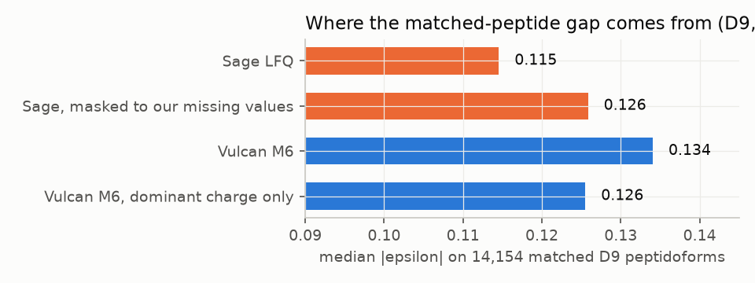

# M6d: LFQ accuracy gap to Sage on D9, the fix, a second HYE-type set, and a fresh MBR truth check (dev only)

- **Data.** Three dev sets, no sealed data. T1 was not opened and nothing under `data/sealed` was read. §6, the metrics (`vulcan/quant/metrics.py`), the labels and the truth definitions are unchanged.
  - **D9** (M6): ProteoBench DDA-Astral HYE A/B × 3.
  - **D11** (new): PXD003881 IonStar, human + E. coli. Group E (3×) × 4 vs group A (1×) × 4, Orbitrap Fusion, 2.5 h. See DATA.md "D11".
  - **D12** (new): PXD014415 Lim 2019, Lumos, 90 min. Six human+yeast donor runs and three human-only acceptor runs. See DATA.md "D12".
  - The dataset ids skip D10 so they are not confused with decision D10.
- **D11 truth.** Expected log2(E/A) comes from the PRIDE description: E. coli is 3% vs 9% of total protein, human 97% vs 91%. Expressed in the human-normalised frame that our label-free median normalisation produces, this is **human 0, E. coli +1.677** (log2(3·97/91)). It was written into `config.yaml` before any D11 quant number existed.
- **Node.** gpu-node, shared, load 35–110 throughout.
- **Files:**
  - `metrics.json`: everything, from `scripts/m6d/summarize.py`.
  - `diag_d9.json` and `diag_tables/*.tsv`: the diagnosis, plus the D9-selection and D11 grids.
  - `plots/*.png`.
  - The paired per-value table (`diag_long.parquet`, 8.6 MB) is not committed; `scripts/m6d/diag_d9.py` regenerates it.
  - `timings.jsonl`: locked timings.
  - `config.yaml`, `git_sha`.
- **Code:**
  - `vulcan/quant/lfq.py`: `XICParams`, `combine_isotopes`, `_xic_iso`, `charge_siblings`. `xic_requant(params=None)` reproduces M6 exactly.
  - `scripts/m6d/*`.
  - `scripts/m6/lfq_d9.py --xic m6|m6d`, default m6d.
  - `tests/quant`: 2 new tests, 9/9 pass.

## 1. Diagnosis (D9, MBR off, the 14,154 peptidoforms quantified by both tools; Sage per-peptide values as the paired reference)

| view (matched set) | median abs ε | H / Y / E |
|---|---|---|
| Sage LFQ | **0.1145** | 0.113 / 0.122 / 0.121 |
| Vulcan M6 | 0.1340 | 0.130 / 0.142 / 0.180 |
| Sage, its values masked to **our** missing cells | 0.1258 | 0.124 / 0.131 / 0.130 |
| Vulcan M6, rows complete in all 6 runs (6,034), vs Sage on the same rows | 0.1113 vs 0.1057 | |
| Vulcan M6, 1,083 peptidoforms whose **charge-state set differs between runs**, vs Sage | **0.297** vs 0.097 | |
| Vulcan M6, all other peptidoforms, vs Sage | 0.128 vs 0.116 | |
| Vulcan M6, dominant charge only | 0.1255 | |

**Root causes, in order of size:**

1. **Charge-state summation with run-varying charge sets** (the largest value-level error).
   - The matched comparison is at peptidoform level, with charges summed (Sage reports charge-combined values). With MBR off, we only have the charge states that were MS2-identified in that run.
   - For 7.6% of matched peptidoforms, one run sums z=2+3 while another has only z=2. That shifts ratios by the minor charge state's share (ε 0.30).
   - Sage integrates every charge state in every run, so it never has this problem.
   - It accounts for about 0.008 of the 0.019 gap.
2. **Missing values (fewer replicates per mean).**
   - Masking Sage to our missingness raises its ε from 0.1145 to 0.1258, so about 0.011 of the gap is replicate count, not value accuracy. Sage always borrows identity, so it is 100% complete.
   - This is a design difference (MBR off), not a bug. MBR on closes it (§2).
3. **Isotope dropouts at low abundance** (E. coli is 5% in A).
   - Adding more isotopes makes E. coli worse: mono 0.129, M0–1 0.134, M0–2 (M6) 0.162, M0–4 0.186.
   - The weak M+2 (and higher) peaks drop below the centroiding threshold in the low-abundance condition, so A is under-counted and ratios expand (log2FC −2.04 vs −2.01 for mono).
   - Mono alone is the most linear but noisy (CV 6.0% vs 5.0%).
   - The averagine projection (each isotope weighted by its expected share) keeps the CV and removes most of the bias (E. coli 0.141).
   - See `integration_variants.tsv`.
4. **Integration window too narrow** (1× the median hill width).
   - Widening it lowers human and yeast ε and CV: ×1.5 gives precursor ε 0.126 and CV 4.5%, vs 0.130 and 5.0%.
   - It slightly hurts E. coli with M0–2, which is the same tail-censoring effect.
   - Fixed widths (0.05–0.2 min) are worse than per-precursor widths.
   - Centring on the aligned consensus RT is worse than the run's own apex (0.134).
   - Feature hill bounds are the worst (0.166, as in M6).
5. **Feature-to-PSM linking (wrong feature).** A minor cause.
   - Only 0.75% of values have the run's feature apex more than 0.1 min off the cross-run consensus (alignment SD is 0.3 s). Values more than 5 SD off have 17–21% large paired residuals (|Δ| > 0.5 log2), vs 0.4% for the rest.
   - Re-centring such windows on the consensus made D9-selection worse, so it was not adopted. On D11 it was slightly better.
6. **Interference and co-elution.** Not a measurable driver.
   - Paired residual vs the M−1 signal (an overlapping envelope) and vs XIC isotope cosine: |resid| > 0.5 rises only from 1.4% to 3–6% in the worst bins, which hold 1–3% of values.
   - Short XICs (≤ 3 scans with a mono signal, 1% of values) are noisier.
   - Median |paired residual| is 0.038 log2. Values: tolerance ±3 to ±10 ppm, max vs summed centroids, and feature vs theoretical m/z all change ε by ≤ 0.003.
7. **Intensity dependence.** Both tools degrade at low intensity. Our excess is largest in the lowest Sage-intensity quintile (0.218 vs 0.184), where only 17.5% of our rows are complete (`eps_by_intensity.png`).

## 2. Fix and measurement (selection = D9 runs A_REP1, A_REP2, B_REP1; confirmation = D9 A_REP3, B_REP2, B_REP3, and D11)

- **Selection.**
  - `scripts/m6d/grid.py d9 sel` rebuilt links, alignment and widths from the 3 selection runs only. It searched:
    - window {1, 1.25, 1.5, (1.75, 2.0)}×;
    - isotopes {M0–2, M0–1, averagine projection};
    - apex re-centring on/off;
    - charge-sibling completion on/off.
  - The IDs are the 6-run pooled TDC of M6. The held-out runs' PSMs affected only the 1% score threshold.
  - **Chosen (m6d):**
    - averagine projection of M0..M2;
    - window 1.5× the median mono-hill width (the gain plateaus at 1.5–2.0×, and E. coli worsens beyond 1.5);
    - no re-centring;
    - **charge-sibling completion**: in runs where a peptidoform is MS2-quantified, integrate its other charge states (seen in any run) at the same apex, with mono present in ≥ 3 scans. Provenance is `ms2_sibling`, never an ID, and no identity crosses runs.
  - MBR settings are untouched.
- **Results** (§6.8 metrics, unchanged). *n* is precursors with ≥ 1 value per condition. CV is the median over ≥ 3 values (≥ 2 for the 3-run subsets, marked ²). DE uses directLFQ / MaxLFQ: standardised pAUC over FPR ≤ 5%, and TPR at 5% FDP (dLFQ).

| set | MBR | version | n prec | prec ε (H/Y/E) | prec CV | compl. | pep-form ε | matched ε vs **Sage** | DE pAUC dLFQ / MaxLFQ | TPR@5% |
|---|---|---|---|---|---|---|---|---|---|---|
| D9 all 6 | off | M6 | 18,933 | 0.130 (0.128/0.133/0.162) | 5.0% | 0.586 | 0.136 | 0.134 vs **0.1145** | 0.625 / 0.568 | 0.455 |
| | off | **M6d** | 19,565 | **0.122** (0.120/0.125/0.171) | **4.6%** | 0.600 | **0.120** | **0.118** vs 0.1145 | **0.656** / 0.589 | 0.470 |
| | on (q≤1%) | M6 | 23,695 | 0.134 (0.128/0.146/0.221) | 5.7% | 0.760 | 0.136 | 0.121 vs 0.1145 | 0.633 / 0.531 | 0.488 |
| | on | **M6d** | 24,071 | **0.125** (0.119/0.134/0.219) | **5.2%** | 0.764 | **0.125** | **0.111** vs 0.1145 | **0.658** / 0.565 | **0.553** |
| D9 selection (A1,A2,B1) | off | M6 → M6d | 13,878 → 14,385 | 0.145 → **0.136** | 4.3 → 3.9%² | 0.68 → 0.69 | 0.150 → 0.132 | 0.148 → **0.131** vs 0.142 | n/a (1 B run) | |
| | on | M6 → M6d | 18,619 → 18,867 | 0.152 → **0.141** | 4.6 → 4.3%² | 0.81 → 0.82 | 0.152 → 0.139 | 0.142 → **0.131** vs 0.142 | | |
| **D9 held-out (A3,B2,B3)** | off | M6 → M6d | 13,932 → 14,431 | 0.137 → **0.130** | 4.2 → 3.8%² | 0.69 → 0.70 | 0.142 → 0.128 | 0.140 → **0.126** vs 0.137 | n/a (1 A run) | |
| | on | M6 → M6d | 18,712 → 18,951 | 0.144 → **0.136** | 4.6 → 4.2%² | 0.82 → 0.82 | 0.146 → 0.135 | 0.136 → **0.126** vs 0.137 | | |
| **D11 (E×4 vs A×4)** | off | M6 | 22,451 | 0.108 (H 0.104 / E 0.165) | 11.5% | 0.598 | 0.118 | (no Sage run) | 0.898 / 0.924 | 0.857 |
| | off | **M6d** | 24,438 | **0.106** (0.102 / **0.192**) | **12.3%** | 0.642 | **0.099** | | 0.898 / 0.927 | 0.848 |
| | on | M6 | 26,726 | 0.110 (0.106 / 0.167) | 12.0% | 0.708 | 0.114 | | 0.876 / 0.908 | 0.820 |
| | on | **M6d** | 27,856 | **0.107** (0.102 / 0.193) | 12.2% | 0.729 | **0.103** | | 0.884 / 0.912 | 0.836 |

On the **same precursors as M6** (`same_precursors_as_m6`), the added sibling precursors drop out of the denominator:

| set | MBR | M6 ε / CV | M6d ε / CV | M6d without sibling values ε / CV |
|---|---|---|---|---|
| D9 | off | 0.130 / 4.8% | **0.120 / 4.4%** | 0.120 / 4.5% |
| D9 | on | 0.134 / 5.7% | **0.124 / 5.1%** | 0.124 / 5.2% |
| D11 | off | 0.108 / 11.4% | **0.100** / 11.8% | 0.101 / **11.0%** |
| D11 | on | 0.110 / 11.9% | **0.102** / 12.0% | 0.104 / **11.1%** |

How to read it:
- **D9.**
  - The fix removes 0.016 of the 0.019 matched gap with MBR off (0.134 → 0.118 vs Sage 0.1145). The rest is replicate count.
  - With MBR on we now beat Sage on the matched set (0.111 vs 0.1145) and on the 3-run subsets, at a lower CV (4.6% vs Sage 5.4%).
  - Precursor ε and CV improve on the held-out runs by the same margin as on the selection runs (0.137 → 0.130 vs 0.145 → 0.136), so the choice did not overfit the selection runs.
  - DE pAUC rises for every roll-up: dLFQ 0.625 → 0.656, MaxLFQ 0.568 → 0.589, Top3 0.382 → 0.403.
  - **E. coli precursor ε gets slightly worse at full depth with MBR off** (0.162 → 0.171): this is the wider window's tail cost on the low-abundance side.
- **D11** (confirmation, not used for selection):
  - The peptidoform ε gain reproduces (0.118 → 0.099), as does precursor ε on the same precursors (0.108 → 0.100). DE pAUC is flat or slightly up (dLFQ 0.898 → 0.898, MaxLFQ 0.924 → 0.927; Top3 0.817 → 0.849).
  - **Two costs on D11:**
    - The E. coli precursor ε rises (0.165 → 0.192). The E. coli log2FC goes from +1.785 to +1.802 against an expected +1.677, so expansion is already present in M6. The D11 grid (`grid_d11_all.tsv`) shows the window widening drives this; isotope weighting does not (avgproj 1× gives 0.149 vs M0–2 1× at 0.165).
    - Precursor CV rises by 0.4–0.8 points. **This comes from the sibling values.** Without them, M6d has ε 0.101 and CV 11.0%, i.e. lower than M6's 11.4%. Siblings are the weak charge states: they help peptidoform roll-up but add noisy values at precursor level.
  - **Open (not adopted, because D11 informed it):** keep sibling values only for peptidoform and protein roll-up, not in the precursor table. A width rule that adapts to abundance could avoid the low-abundance tail cost.

## 3. Fresh MBR truth check (D12; M6 MBR settings unchanged)

- **Settings.** `MBRParams()` defaults; donors at ID q ≤ 0.1%; claimed-feature exclusion; per-acceptor-run transfer q; fixed a-priori score.
- **Experiment.** 9 runs: 6 human+yeast donors and 3 human-only acceptors. IDs are pooled over all 9 runs, with 41,331 peptidoforms at 1%.
- **Truth.** A transfer of a yeast-unique, non-contaminant precursor into an acceptor run is false. This is the M6 definition.
- **Script check.** `scripts/m6d/mbr_truth.py` reproduces the M6 D9 numbers exactly (10,806 accepted, 68 false, 0.63% / 1.23%).
- **Transfer score.** It uses feature hill areas, so the M6d XIC change does not affect which transfers are accepted.

| set | nominal transfer q | accepted in acceptors | false (yeast) | FDP lower bound | combined estimate | null subset: false target wins / RT-decoy / m/z-decoy wins |
|---|---|---|---|---|---|---|
| D9 (M6 set, reproduced) | 1% | 10,806 | 68 | 0.63% | 1.23% | 196 / 205 / 82 |
| D9 | 5% | 13,031 | 345 | 2.65% | 5.19% | 345 / 353 / 167 |
| **D12 (fresh)** | **1%** | **22,383** | **41** | **0.18%** | **0.79%** | 41 / 17 / 8 |
| **D12** | **5%** | 22,383 | 41 | 0.18% | 0.79% | (identical: no transfer has q > 0.41%) |

- **Candidates.** 39,081 candidates into acceptors: 9,003 are yeast nulls and 29,918 human.
  - 0.46% of the yeast nulls are accepted, vs 74.7% of human candidates.
  - Per acceptor run, the lower bound is 0.13–0.28%.
  - MS2 IDs in the acceptors: 53 of 77,690 PSM winners are yeast-unique.
- **Verdict.** At nominal 1% the true false-transfer rate on D12 is 0.18% (lower bound) to 0.79% (combined estimate), within nominal. At nominal 5% it is the same 0.18–0.79%, i.e. conservative: on D12 the q-value never reaches 1%, so acceptance is decided by "beats both decoy peaks" alone.
- **Two caveats** that a D9-only view hid:
  - In the pure-null subset, **the RT-shifted decoy under-counts false target wins by about 2.4× on D12** (17 vs 41). On D9 it was exchangeable (205 vs 196).
  - The estimated q of the accepted set (≤ 0.41%) is below the combined true estimate (0.79%).
  - Control holds here because the null share among acceptor candidates is small (23% vs 51% on D9). The D9 tuning of the decoy model does not transfer as an exchangeability property.
  - This is the m/z-decoy problem of M6 appearing for the RT decoy on a 90 min Orbitrap gradient (wider peaks, RT SD 1.7 s vs 0.3 s on Astral). It should be fixed before MBR is defaulted, e.g. RT-decoy windows drawn from local feature density.

## 4. Runtime (locked, `flock /tmp/vulcan_bench.lock`, 2 reps each; D9 6 runs, MBR on, without directLFQ; `timings.jsonl`)

| version | process wall / core-s | XIC re-quant | siblings | rest (link + align + MBR + Top3 + MaxLFQ) |
|---|---|---|---|---|
| M6 | 21.9, 16.1 s / 18.6, 18.3 | 2.2, 1.5 s | – | about 6–10 s |
| M6d | 19.4, 18.4 s / 17.8, 19.3 | 1.4, 1.7 s | 1.1, 1.8 s (0.2–0.3 s/run) | about 6–8 s |

- **Impact.** No measurable change in process core-seconds: 18.5 vs 18.5, within the noise of a loaded node.
  - The new cost is the sibling pass, 0.2–0.3 s per Astral run (0.3 s per 2.5 h Fusion run on D11).
  - The 1.5× window does not change the XIC cost.
  - directLFQ (single core, 26–38 s per experiment) still dominates quant roll-up.
- **New front ends** (per run, unlocked):
  - D11: ingest 7 s, MS1 8–10 s, search 1.2 s, scoring 9 s.
  - D12: 7 / 6 / 1.2 / 7 s.

## 5. Issues / open
- **Sibling values at precursor level** (§2): they help peptidoform ε on both sets, but raise the precursor CV on D11.
- **The low-abundance window cost** for E. coli (D9 +0.009, D11 +0.027).
- **The D12 RT-decoy under-count.** MBR stays opt-in.
- **Status of the three sets.**
  - D11 is now a selection-informed set for the sibling question.
  - D9 numbers remain dev.
  - D12 is untouched by any setting choice. Only the truth check was run on it.
- **Sage was not run on D11**, so there is no paired reference there.
- **The D9 IDs used for the 3-run subsets** come from the 6-run pooled TDC (§2).
